# TiRT

Thermal infrared radiative transfer model for vegetation, terrain, urban surfaces, and coupled scenes.

本文分为四个部分：

1. [简介](#一简介)：模型组成、安装、运行、输入与绘图。
2. [TiRT 角度验证](#二tirt-角度验证与-histream-三维路径追踪对比)：与 HiSTREAM 三维路径追踪逐角度对比。
3. [TiRT 时间验证](#三tirt-时间验证tirteb-与-scope-对比)：能量平衡时间序列 TIRTEB 与 SCOPE 对比。
4. [界面介绍](#四界面介绍)：桌面窗口、本地页面和打包发布。

## TiRT 1.1.2 Windows 版本

原生单文件exe见[GitHub Releases](https://github.com/bianzj/tirt/releases/tag/v1.1.2)，双击启动，无需安装Python。页眉保留蓝色 STREAM、红色 TIRT 标识，静态／动态模型分别标为 TIRT-Static 和 TIRT-Dynamic。沿用1.1.1的时间接口、动态参数、上传光谱及城市自动漫射比例修复。程序包含当前光学/热红外模型及可直接复算的10组场景验证。

```powershell
# 从源码构建（需要PyInstaller）
python scripts/build_tirt_release.py
# 使用exe复算内置模型验证，结果写入指定目录
.\TiRT.exe --verify-model .\verification
```

Windows构建、检查和发布说明见[版本说明](docs/releases/v1.1.2.md)。

## 当前光学与热红外模型验证（2026-10-15）

新增红光/近红外、整冠双热点、山地共享交换、垄行通道修正和城市森林热红外双热点。当前10组场景、30张三波段图及同场景HiSTREAM参考见[当前模型验证](docs/validation/current_model_20261015/README.md)。完整输入、逐方向结果和参考统计随仓库提供。分支、配置和公式见[当前模型说明](docs/current_model.md)。

```bash
python scripts/verify_physics.py
python scripts/validate_current_model.py --plots
```

新分支的实际配置见验证目录inputs；当前山地采用“仅统一交换闭合”，未全局替换其他场景分支。历史验证在原目录保留。

## 一、简介

TiRT 用于典型复杂地表热红外方向性辐射传输建模，可计算不同观测角度下的方向亮温、辐射亮度和有效发射率。

TiRT 包含两条计算链：

- **方向性辐射传输（`run.py`）**：给定组分温度，计算各观测方向、各波段的亮温和辐亮度。
- **能量平衡时间序列（TIRTEB，`tirteb_run.py`）**：由气象数据驱动，逐时间步求解土壤、叶片和城市组分的温度与 Rn、LE、H、G，再用同一套 TiRT 辐射传输计算方向亮温。两者共用一套参数名称和含义（`input.csv` 与 `input_tirteb.csv`）。

### 适用场景

- 均质植被
- 垄行作物
- 离散树冠
- 坡面植被
- 复杂地形
- 城市建筑
- 城市建筑与街道植被耦合场景

### 核心模型

- `Hom`: 均质植被解析模型
- `Row`: 垄行作物解析模型
- `Crown`: 离散树冠解析模型
- `Hom_Voxel`: 均质植被体素模型
- `Row_Voxel`: 垄行作物体素模型
- `Crown_Voxel`: 离散树冠体素模型
- `Slope_Veg`: 坡面植被模型
- `Terrain`: 地形模型
- `Terrain_Veg`: 地形-植被耦合模型
- `Urban`: 城市建筑模型
- `Urban_Veg`: 城市-植被耦合模型

能量平衡部分的方法（组分通量、冠层辐射、空气动力学和气孔阻抗）见 [TIRTEB 理论与方法说明](docs/TIRTEB_theory_and_methods.md)。

### 环境安装

建议使用 Python 3.10+。

```powershell
cd C:\work\tirt
py -m venv .venv
.\.venv\Scripts\activate
pip install -r requirements.txt
```

如果 `GDAL` 安装失败，可先安装核心依赖运行主要模型：

```powershell
pip install numpy scipy matplotlib pandas scikit-learn seaborn xlrd opencv-python netCDF4 pysolar
```

### 统一运行入口

项目根目录提供了单点运行方式。默认读取根目录的 `input.csv`，结果写入 `cases/<case_name>/output.csv`：

```bash
python run.py
```

也可以在 Python 中调用外层函数，或通过命令行切换模型：

```python
from run import run

output_path = run("input.csv")
print(output_path)
```

```bash
python run.py --input input.csv --output cases/row_demo/output.csv --model row
```

统一入口支持植被与地表的组合模型：`plane`、`slope`、`terrain`、`urban` 地表可分别组合 `bare`、`hom`、`row`、`crown` 植被。参数集中在 `input.csv`，输出按“观测方向 × 波段”记录亮温、辐亮度和各组分发射率。

能量平衡时间序列：

```bash
python tirteb_run.py --input input_tirteb.csv --output cases/my_case/output.csv
```

| 需求 | 入口 | 输入 | 输出 |
| --- | --- | --- | --- |
| TiRT 方向亮温、发射率 | `run.py` | `input.csv` | `cases/<case>/output.csv` |
| TiRT 桌面界面 | `desktop/main.mjs` | `input.csv`、`input_tirteb.csv` | Electron 窗口 |
| TiRT 能量平衡批处理 | `tirteb_run.py` | `input_tirteb.csv` | `output.csv`、`observations.csv` |
| TiRT 多角度批处理 | `angle_run.py` | `input_tirteb.csv` | 角度结果 `output.csv` |

### input.csv 结构

输入分组采用 `section,key,value,description` 格式：

- `[surface]`：`surface_model` 选择平面、单一坡、复合地形或城区地表，`vegetation_model` 选择裸地、均质植被、垄行或森林。
- `[vegetation_structure]`、`[row_structure]`、`[crown_structure]`：分别配置 LAI、热点、垄行和树冠结构。
- `[slope]`：配置单一坡的坡度和坡向；`[terrain]` 配置复合地形层，可用分号提供多个高度、半径和密度参数。
- `[spectral]`、`[soil_anisotropy]`、`[urban_spectrum]`：配置热红外高光谱波段，以及叶片、土壤、屋顶、墙壁和街道发射率；每组常数发射率的数量必须与 `wavelengths` 数量一致。选择 `bare` 时，`hapke_enable=1` 启用 Hapke/Thapke 土壤方向性修正，`hapke_K` 控制各向异性强度。
- `[thermal]`：配置土壤、叶片、地形、屋顶、墙壁和街道的日照/阴影温度。
- `[geometry]`：通过 `geometry_mode` 选择观测角度来源：`0` 为 `vza/vaa` 给定角度，`1` 自动生成主平面，`2` 从 TXT 文件读取，`3` 以一个天顶角步长同时生成太阳主平面和垂直太阳主平面，并追加文件或手动的一一对应观测角度。

能量平衡模板 `input_tirteb.csv` 使用同一套参数名称和含义（地表、坡面、地形、建筑、垄行、树冠、热红外发射率、观测几何和波段），组分温度由能量平衡求出，热红外方向辐射直接调用 TiRT 的辐射传输，见 [TIRTEB 理论与方法说明](docs/TIRTEB_theory_and_methods.md#参数体系)。

这里的光谱是热红外高光谱，不是可见光/近红外反射率。光谱文件支持：叶片文件为 `wavelength leaf_emissivity`，土壤文件为 `wavelength soil_emissivity`，建筑文件为 `wavelength roof_emissivity wall_emissivity street_emissivity`；也兼容 7 列建筑文件，读取其中最后三列发射率。文件中的波段会插值到 `wavelengths`。

几何文件每行支持 `vza vaa`，也支持 `vza vaa sza saa`；角度单位为度，注释行以 `#` 开头。模式 1 使用相对太阳方位角 `0/90/180/270`，可通过 `principal_vza` 或 `principal_vza_step`、`principal_vza_max` 设置天顶角；设置 `geometry_view=parallel` 或 `geometry_view=perpendicular` 可只生成对应的两个方向。

项目提供了半球观测方向文件 `data/directions/hemisphere_directions.txt`：方位角间隔 30°、天顶角间隔 10°，覆盖 0° 到 90° 天顶角。使用该文件时设置：

```text
geometry,geometry_mode,2,read TXT directions
geometry,geometry_file,data/directions/hemisphere_directions.txt,hemisphere directions
```

### 方向性绘图

`plot/` 用于读取统一入口生成的 `output.csv`，绘制热红外方向性结果。默认绘制摄氏度亮温，也可以选择开尔文亮温、辐亮度或其他数值列：

```bash
python -m plot.run_plot \
    --input cases/file_geometry_spectrum/output.csv \
    --mode all \
    --wavelength 10.5
```

可选模式为：

- `polar`：极坐标方向图，角度为观测方位角 `vaa`，半径为观测天顶角 `vza`。
- `parallel`：太阳主平面图，使用相对太阳方位角 `raa=0/180` 的方向。
- `perpendicular`：垂直太阳主平面图，使用相对太阳方位角 `raa=90/270` 的方向。
- `all`：一次输出以上三类图；如果输入几何没有对应方向，则跳过该类图。

默认图像写入 `cases/<case_name>/plots/`，也可以指定目录和绘制量：

```bash
python -m plot.run_plot \
    --input cases/file_geometry_spectrum/output.csv \
    --mode polar \
    --wavelength 10.5 \
    --quantity brightness_temperature_K \
    --output-dir cases/file_geometry_spectrum/plots_K
```

绘图依赖 `matplotlib`，安装项目依赖后即可使用。

### 基本用法

```python
import numpy as np
from base.hom import Hom

lai = 0.5
hspot = 0.15
wavelength = 10.5
emissivity_leaf = 0.985
emissivity_soil = 0.955

temperature_leaf_sunlit = 303
temperature_leaf_shaded = 300
temperature_soil_sunlit = 320
temperature_soil_shaded = 305

sza = 25
vza = np.hstack([np.linspace(50, 1, 50), np.linspace(0, 50, 51)])
raa = np.zeros_like(vza)

hom = Hom()
hom.set_structure(lai, hspot)
hom.set_optical(wavelength, emissivity_soil, emissivity_leaf)
hom.set_thermal(
    temperature_soil_sunlit,
    temperature_soil_shaded,
    temperature_leaf_sunlit,
    temperature_leaf_shaded,
)
hom.set_angle(vza, sza, raa)

brightness_temperature = hom.run()
```

低层模型示例：

```powershell
python -m base.run_tirt_veg
python -m base.run_tirt_vegvoxel
python -m base.run_tirt_slopeveg
python -m base.run_tirt_terrain
python -m base.run_tirt_terrain_veg
python -m base.run_tirt_urban_bt
python -m base.run_tirt_urbanveg_bt_polar
```

### 目录结构

```text
tirt/
├── run.py                  # TiRT 统一方向性辐射传输入口
├── tirteb_run.py           # TiRT 能量平衡批处理入口
├── angle_run.py            # TiRT 多角度批处理入口
├── input.csv               # TiRT 默认输入模板
├── input_tirteb.csv        # 能量平衡默认输入模板
├── base/                   # 统一 Python 核心包（保持 base 导入兼容）
│   ├── gap.py              # 间隙概率与几何路径
│   ├── hotspot.py          # 热点效应
│   ├── proportion.py       # 四组分方向比例
│   ├── scatter.py          # VNIR/TIR 散射
│   ├── hom/row/crown*.py  # 均质、垄行、树冠及体素模型
│   ├── terrain*.py         # 坡面、复合地形及地形植被模型
│   ├── urban*.py           # 城市建筑及城市植被模型
│   ├── inputio.py          # TiRT 与 TIRTEB 共用的参数解析
│   ├── radiation.py        # 统一辐射准备、合并和诊断
│   ├── rt_transfer.py      # 能量平衡的冠层短波、长波传输
│   ├── aerodynamic.py     # 空气动力学阻抗
│   ├── biochemical.py      # 光合/气孔阻抗
│   ├── evapo.py/eb.py      # 蒸散、能量平衡和热量更新
│   ├── io.py/modelio.py    # 能量平衡输入、光谱和结构解析
│   ├── structs.py          # 能量平衡数据结构
│   ├── util_*.py           # TiRT 历史示例使用的辅助工具
│   └── run_tirt_*.py       # 低层 TiRT 示例和回归入口
├── data/
│   ├── defined/            # 光谱系数、太阳光谱和气象数据
│   ├── directions/         # 观测方向文件
│   └── spectrals/          # TiRT 示例观测光谱
├── benchmark/              # 与 HiSTREAM、SCOPE 的对比脚本
├── cases/                  # 输入案例及运行结果（结果可重新生成）
├── gui/                    # TiRT 统一页面、时间序列和角度页面
│   ├── server.py           # TiRT GUI 服务（默认 8765）
│   ├── tirteb_server.py    # 能量平衡 API 兼容模块
│   └── angle/              # TiRT 角度页面
├── desktop/                # Electron 桌面窗口和服务生命周期管理
├── package.json            # Electron 开发/打包脚本
├── electron-builder.yml    # Windows 安装包配置
├── plot/                   # 输出 CSV 的方向性绘图工具
├── analysis/               # 结果分析脚本和分析产物
├── scripts/                # 回归验证和截图脚本
├── tests/                  # GUI、物理和回归测试
├── docs/                   # 用户手册、方法说明和验证图件
├── .vscode/                # 可选的 VS Code 运行和调试配置
└── *.{bat,command}         # 启动和打包脚本
```

### VS Code 使用

用 VS Code 打开项目根目录：

```powershell
code C:\work\tirt
```

选择 Python 解释器：

```text
Ctrl+Shift+P
Python: Select Interpreter
```

选择已安装依赖的 Python 或 conda 环境。

项目已提供 `.vscode/settings.json` 和 `.vscode/launch.json`，会自动把项目根目录和上一级目录加入 `PYTHONPATH`。这样从子目录运行脚本时也能找到：

```python
from base.xxx import *
```

### 常见问题

#### No module named 'base'

原因是 Python 搜索路径没有包含项目根目录。请从 `C:\work\tirt` 运行，或设置：

```powershell
$env:PYTHONPATH="C:\work\tirt;C:\work"
```

#### No module named 'scipy'

当前环境没有安装依赖：

```powershell
pip install -r requirements.txt
```

#### planck() missing argument

新版 `planck` 已兼容两种写法：

```python
planck(temperature)
planck(wavelength, temperature)
```

建议新代码优先显式传入波长：

```python
planck(10.5, temperature)
```

## 二、TiRT 角度验证（与 HiSTREAM 三维路径追踪对比）

TiRT 与 HiSTREAM 三维路径追踪（eRaytracing）在 11 个场景下进行了逐角度对比，条件为 10.5 µm、太阳天顶角 30°、太阳方位角 0°，观测天顶角 0–75°（步长 5°）。图中同时给出“一维均质假设”的结果：同样的 LAI、发射率和组分温度，但地表视为平地、植被视为水平均质层，不考虑坡面、地形、建筑和冠层结构。它体现了 TiRT 从一维假设向近似三维建模的改进。

每张图从左到右依次为场景示意、太阳主平面（+ 为太阳一侧）和垂直太阳主平面（+ 为东），两个平面使用相同的亮温坐标范围。

| 场景 | TiRT RMSE / 偏差 (K) | 一维均质 RMSE / 偏差 (K) |
| --- | --- | --- |
| 平地裸土 | 0.00 / +0.00 | 0.00 / +0.00 |
| 平地均质冠层（LAI 1.5） | 0.20 / +0.17 | 0.20 / +0.17 |
| 平地离散森林（叶片 0.9 m） | 0.41 / −0.38 | 2.61 / −2.54 |
| 平地离散森林（叶片 0.15 m） | 0.15 / +0.03 | 2.11 / −2.03 |
| 垄行作物（垄向 0°） | 0.13 / +0.01 | 3.13 / −2.51 |
| 垄行作物（垄向 90°） | 0.14 / +0.00 | 0.46 / −0.22 |
| 单坡 30° 朝东 + 均质冠层 | 0.27 / +0.23 | 0.75 / +0.64 |
| 单坡 30° 朝东 + 森林 | 0.13 / +0.01 | 1.64 / −1.44 |
| 复合地形 + 森林 | 0.17 / −0.07 | 2.27 / −2.24 |
| 城市（无植被） | 0.45 / −0.05 | 3.46 / +2.52 |
| 城市 + 街道森林 | 0.63 / +0.47 | 3.00 / −2.40 |

RMSE 和偏差均相对 HiSTREAM 计算。平地裸土和平地均质冠层本身没有三维结构，因此一维均质与 TiRT 结果相同。

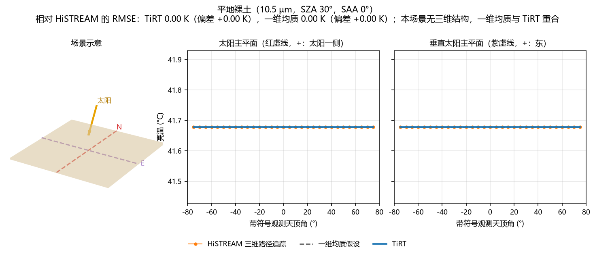


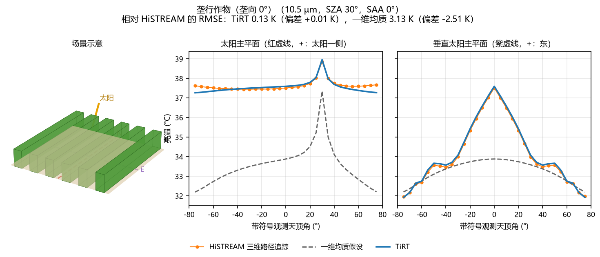


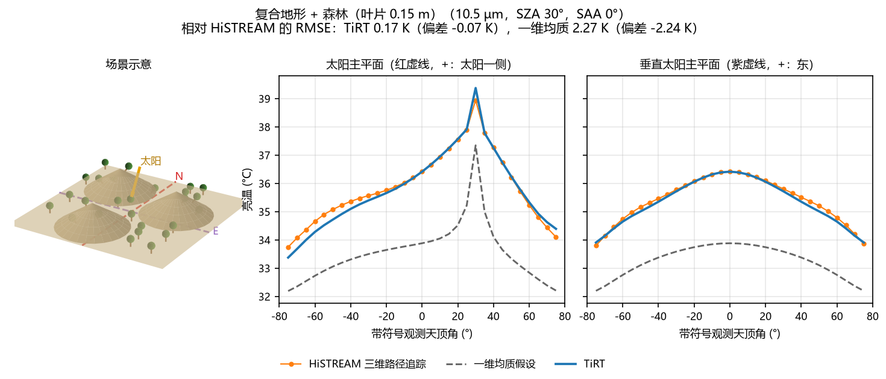
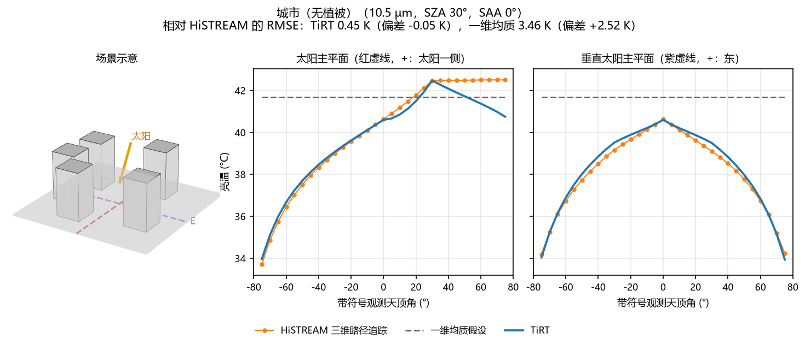
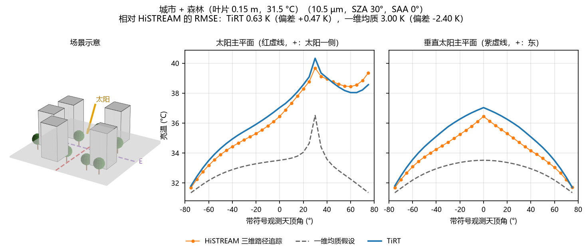

逐场景统计见 [`docs/validation/overview.csv`](docs/validation/overview.csv)，验证脚本和场景设置见 [`benchmark/streamsim/`](benchmark/streamsim/README.md)。HiSTREAM 原始结果（`benchmark/streamsim/runs/`）不入库；按该说明生成后，可重新生成图件：

```bash
cd benchmark/streamsim
python overview_plot.py
```

## 三、TiRT 时间验证（TIRTEB 与 SCOPE 对比）

TIRTEB 用气象数据逐时间步求解组分温度和能量通量，再用 TiRT 计算方向亮温。这里用 SCOPE（Van der Tol et al. 2009；Yang et al. 2021）自带的两套验证算例检验时间维度：TIRTEB 使用与 SCOPE 相同的气象驱动和参数（均质冠层），与 SCOPE 输出的通量、温度和亮温比较。SCOPE 本身不重新运行，参考值取自其发布包中的 `output/verificationdata`。

### SCOPE 1.73：24 小时时间序列

DOY 169，半小时一步共 49 步，LAI 3，冠层高 2 m，纬度 52.25°。TIRTEB 的太阳天顶角与 SCOPE 白天平均相差 0.14°。

| 变量 | 全天偏差 | 全天 RMSE | 白天 RMSE | 夜间 RMSE |
| --- | --- | --- | --- | --- |
| 净辐射 Rn (W/m²) | +13.9 | 14.6 | 15.3 | 12.9 |
| 潜热 LE (W/m²) | +14.8 | 43.3 | 51.9 | 13.6 |
| 感热 H (W/m²) | +8.8 | 39.4 | 41.2 | 35.5 |
| 土壤热通量 G (W/m²) | −8.9 | 12.1 | 13.2 | 9.7 |
| 土壤温度 (K) | −0.1 | 0.8 | 0.5 | 1.2 |
| 冠层温度 (K) | −2.5 | 3.0 | 2.0 | 4.4 |
| 天底亮温 10.5 µm (K) | −0.9 | 1.2 | 1.2 | 1.1 |

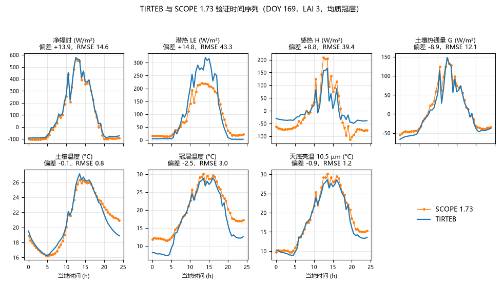

夜间冠层偏冷、感热偏弱来自稳定层结处理的差异：SCOPE 1.73 只在 L > 4000 m 时施加稳定修正，而 L 被限制在 100 m 以内，夜间实际为中性；TIRTEB 保留 Monin–Obukhov 稳定修正（与 SCOPE 2 一致）。

### SCOPE 2：30 个拉丁超立方情景

SCOPE 2 的验证算例在 LAI、叶片色素、Vcmax、Ball-Berry 斜率、叶倾角、入射短波、气温、水汽压、太阳天顶角、观测天顶角和相对方位角上随机取样。每个情景作为 TIRTEB 的一个时间步运行，太阳天顶角、散射比例、粗糙度（SCOPE `zo_and_d`）和土壤光谱与 SCOPE 一致，亮温取各情景自己的观测方向。

| 变量（13 个未饱和情景） | 偏差 | RMSE | r |
| --- | --- | --- | --- |
| 净辐射，对 SCOPE 辐射收支 (W/m²) | +1.8 | 22.9 | 0.99 |
| 潜热 LE (W/m²) | −13.9 | 50.5 | 0.87 |
| 感热 H (W/m²) | −57.2 | 75.1 | 0.90 |
| 冠层温度 (K) | −1.4 | 3.0 | 0.96 |
| 观测方向亮温 10.5 µm (K) | −2.2 | 4.5 | 0.90 |
| 只比辐射传输：TiRT 输入 SCOPE 温度的亮温 (K) | −0.8 | 2.8 | 0.96 |

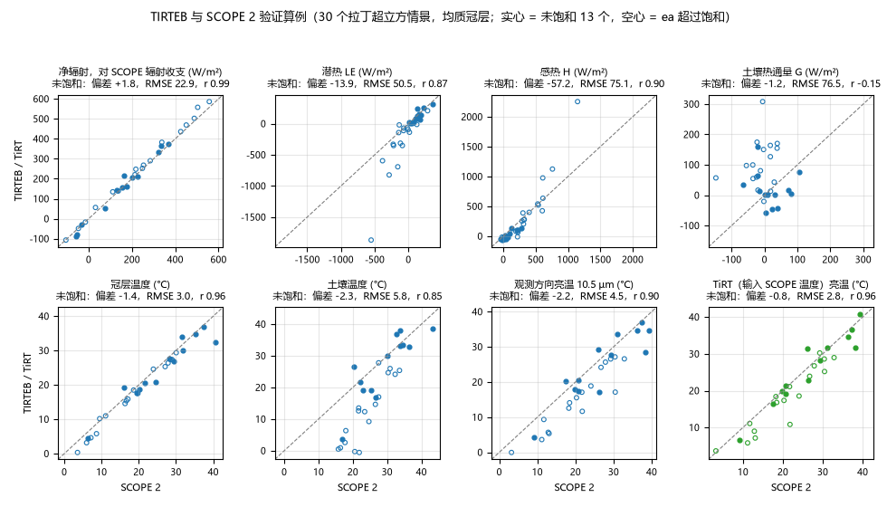

读这组结果时需注意：

- 拉丁超立方把气温和水汽压独立取样，30 个情景中有 17 个水汽压超过饱和（图中空心点），物理上不成立，表中只统计 13 个未饱和情景。
- SCOPE `fluxes.csv` 中的净辐射平均比其自身辐射收支（`radiation.csv` 的入射减反射减发射）高 65 W/m²，SCOPE 的通量按前者闭合，因此 TIRTEB 的感热看起来偏低；净辐射一栏与 SCOPE 自身的辐射收支比较。
- SCOPE 把 30 个情景当作逐日时间序列连续运行，土壤温度和 G 继承上一个情景；TIRTEB 每个情景从气温起算，所以土壤温度和 G 不可比。

统计表见 [`docs/validation/tirteb_scope173_summary.csv`](docs/validation/tirteb_scope173_summary.csv) 和 [`docs/validation/tirteb_scope2_summary.csv`](docs/validation/tirteb_scope2_summary.csv)，对比方法见 [`benchmark/scope/`](benchmark/scope/README.md)。重新生成图件（参数为本机 SCOPE 目录）：

```bash
cd benchmark/scope
python compare_scope.py --scope <SCOPE_v1.73 目录>
python compare_scope2.py --scope <含 SCOPE.m 的 SCOPE 2 目录>
```

## 四、界面介绍

### TiRT 桌面窗口

能量平衡、时间序列和多角度计算已经属于 TiRT 的功能模块，用户只启动一个 TiRT 桌面窗口：

```bash
npm install
npm run desktop
```

TiRT 窗口使用 Electron 提供，不会显示浏览器标签栏、地址栏或浏览器菜单；页面中的 `Energy balance` 进入时间序列能量平衡，`Directional model` 返回方向性计算。两者共用同一个服务和项目数据，关闭窗口会同时关闭后台服务。

底层批处理仍可直接调用 `tirteb_run.py` 和 `angle_run.py`，它们是兼容接口，不需要单独启动 GUI 服务。

### 软件界面

以下截图均来自项目内置的 TiRT 本地 GUI：

| 主界面 | 结果查看 |
| --- | --- |
| 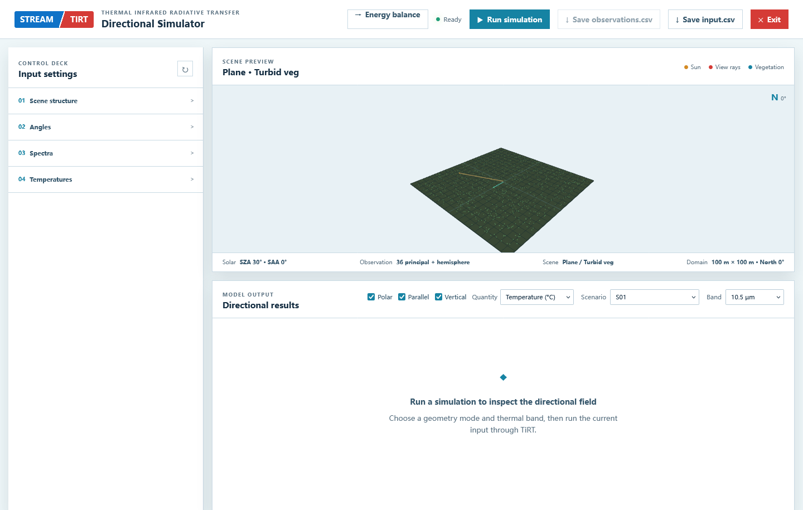 |  |

| 城市场景设置 | 城市场景结果 |
| --- | --- |
| 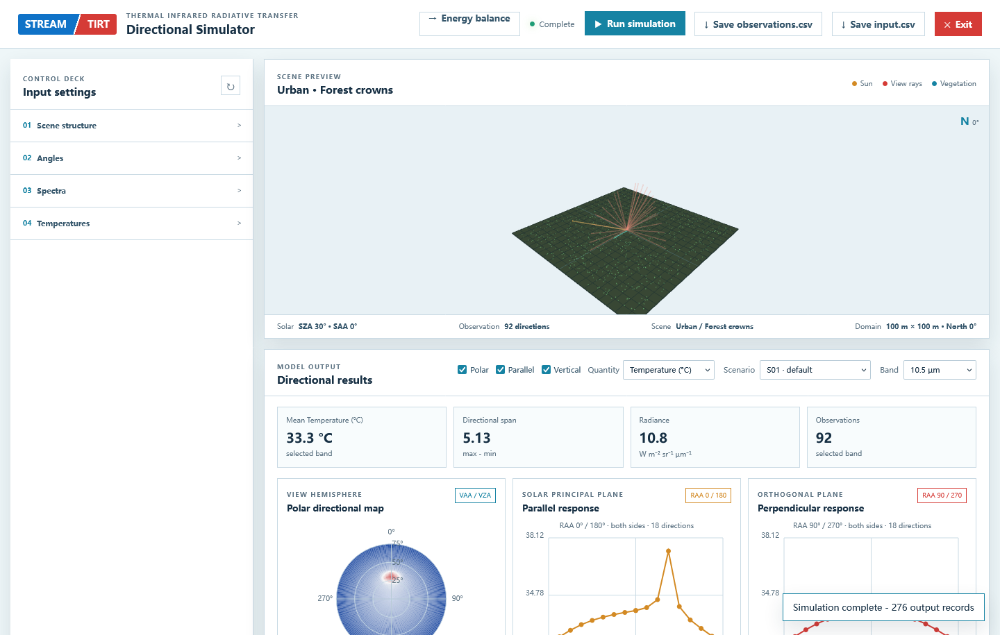 | 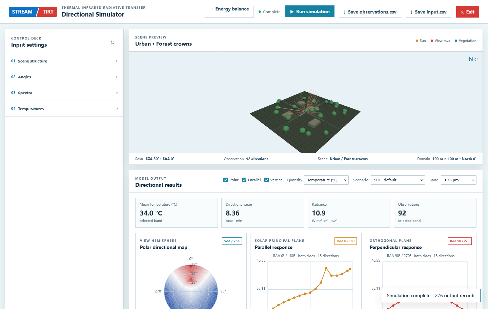 |

| 自定义观测角度 | 移动端界面 |
| --- | --- |
|  | 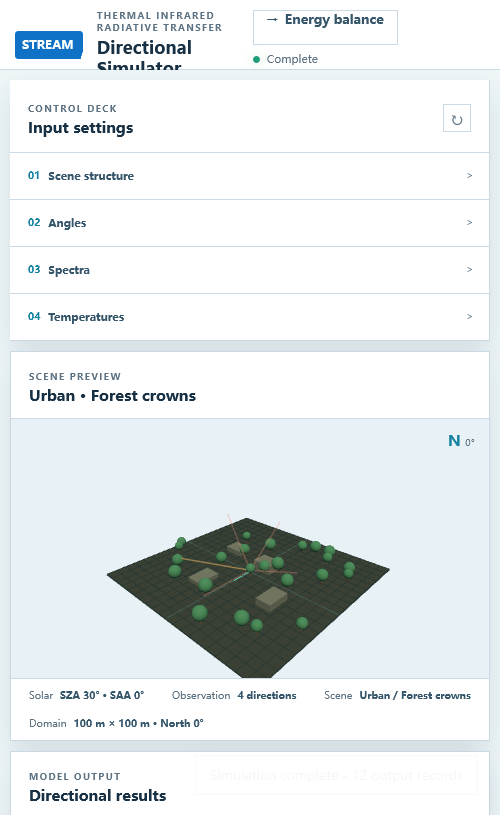 |

| 能量平衡模块 | 能量平衡结果 |
| --- | --- |
| 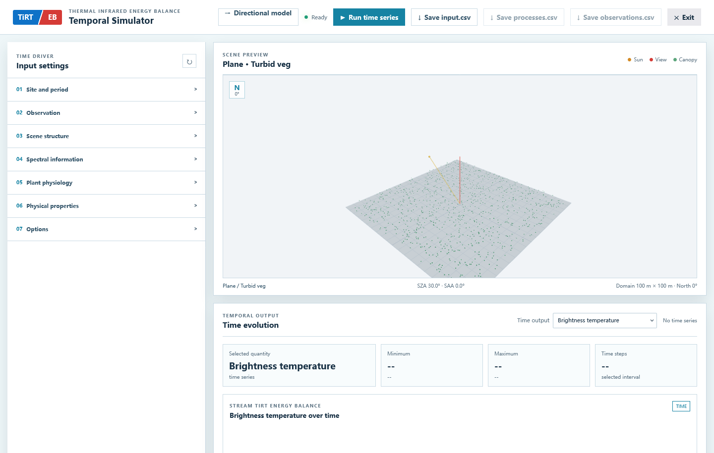 | [查看能量平衡结果图](docs/figures/time_214p056_10p5.png) |

更多场景和移动端截图见 [`docs/screenshots/`](docs/screenshots/)，示例结果图见 [`docs/figures/`](docs/figures/)。

### 本地页面（Three.js 界面）

`gui/` 提供 TiRT 页面，用于设置输入、预览地表场景并查看方向性和时间序列结果：

```bash
python gui/server.py --port 8765
```

打开 `http://127.0.0.1:8765/`。界面中的 Run simulation 会调用根目录现有的 `run()`，结果区域支持极坐标图、太阳主平面图和垂直太阳主平面图；也可以保存当前表单设置的 `input.csv`。能量平衡页面为 `http://127.0.0.1:8765/time.html`，操作步骤见 [能量平衡操作说明](docs/TIRTEB_user_guide.md)。

### 本地一键启动

项目包含 `environment.yml`、macOS 启动脚本 `start_tirt.command` 和 Windows 启动脚本 `start_tirt.bat`。将整个 `tirt` 文件夹复制到另一台已安装 Miniconda 的电脑后，首次运行启动脚本会自动创建 `tirt` 环境并安装依赖，之后每次运行即可启动本地界面。脚本只绑定 `127.0.0.1`，不会对外提供服务。

如果 macOS 不允许直接双击运行，可在项目目录执行一次：

```bash
chmod +x start_tirt.command
./start_tirt.command
```

Windows 用户请安装 Miniconda，然后双击 `start_tirt.bat`。脚本首次运行会根据 `environment.yml` 创建 `tirt` 环境并安装 Python 依赖，同时安装 Electron 桌面依赖，之后启动无浏览器栏的 TiRT 窗口。也可以在 Anaconda Prompt 中执行：

```bat
cd C:\work\tirt
start_tirt.bat
```

### 打包发布

当前项目提供基于 Python/Conda 的开发运行版本和 Electron 桌面发布版本。Windows 下运行 `build_tirt_exe.bat` 会先生成内部 `dist/TiRT-service.exe`，再生成最终安装包 `release/TiRT-Setup-1.0.2-x64.exe`；安装后的 `TiRT.exe` 同时包含方向性、能量平衡和时间变化窗口。macOS 上不能可靠构建 Windows `.exe`。

## 参考文献、联系方式与许可证

### 参考文献

#### Physical

1. Zunjian Bian, Shengbiao Wu, Jean-Louis Roujean, Biao Cao, Hua Li, Gaofei Yin, Yongming Du, Qing Xiao, Qinhuo Liu. A TIR forest reflectance and transmittance (FRT) model for directional temperatures with structural and thermal stratification. Remote Sensing of Environment.
2. Zunjian Bian, Biao Cao, Hua Li, Yongming Du, Wenjie Fan, Qing Xiao, Qinhuo Liu. The Effects of Tree Trunks on the Directional Emissivity and Brightness Temperatures of a Leaf-Off Forest Using a Geometric Optical Model. IEEE Transactions on Geoscience and Remote Sensing, 2020.

#### Semi-Physical

3. Zunjian Bian, Biao Cao, Hua Li, Yongming Du, Jean-Pierre Lagouarde, Qing Xiao, Qinhuo Liu. An Analytical Four-component Directional Brightness Temperature Model for Crop and Forest Canopies. Remote Sensing of Environment, 2018.
4. Zunjian Bian, Qing Xiao, Biao Cao, Yongming Du, Hua Li, Heshun Wang, Qiang Liu, Qinhuo Liu. Retrieval of Leaf, Sunlit Soil, and Shaded Soil Component Temperatures Using Airborne Thermal Infrared Multiangle Observations. IEEE Transactions on Geoscience and Remote Sensing, 2016.

#### Semi-Empirical

5. Zunjian Bian, J. L. Roujean, J. P. Lagouarde, Biao Cao, Hua Li, Yongming Du, Qiang Liu, Qing Xiao, Qinhuo Liu. A semi-empirical approach for modeling the vegetation thermal infrared directional anisotropy of canopies based on using vegetation indices. ISPRS Journal of Photogrammetry and Remote Sensing, 2020.
6. Zunjian Bian, Jean-Louis Roujean, Biao Cao, Yongming Du, Hua Li, Philippe Gamet, Junyong Fang, Qing Xiao, Qinhuo Liu. Modeling the directional anisotropy of fine-scale TIR emissions over tree and crop canopies based on UAV measurements. Remote Sensing of Environment, 2021.

### 联系方式

Email: bianzj@aircas.ac.cn

### 许可证 / License

本项目采用 [PolyForm Noncommercial License 1.0.0](LICENSE)。允许依照许可证进行非商业使用、修改和分发；任何商业使用均须事先取得许可方的单独书面授权。

This project is licensed under the [PolyForm Noncommercial License 1.0.0](LICENSE). Noncommercial use, modification, and distribution are permitted under its terms. Commercial use requires a separate prior written license from the licensor.
