# TIRT 光学验证报告

报告日期：2026-10-24 | 10 个场景 | 红光与近红外方向反射因子

### 研究来源与报告依据

TIRT 光学部分来自闻建光团队的相关研究工作。本报告依据仓库已保存的 2026-10-24 TIRT 复算结果和冻结 HiSTREAM 参考结果整理，不是对原始论文结果的逐项复现。

本次报告编制重新核算逐方向误差、绘制曲线和整理运行示例，未重新运行 TIRT 或 HiSTREAM。输入场景沿用 current_model_20261021 数据包。与热红外主页报告的版本和场景统计口径分别记录。

### 验证范围与总体结果

覆盖平地裸土、均质冠层、离散森林、两种垄向作物、单坡植被、复合山地森林及城市植被。每波段 602 条有效配对，共 1,204 条；相对 HiSTREAM 的误差单位为无量纲 BRF。

| 波段 | n | 整体 RMSE | 整体偏差 | 最大绝对误差 |
| --- | --- | --- | --- | --- |
| 670 nm | 602 | 0.005374 | 0.002753 | 0.029672 |
| 860 nm | 602 | 0.013891 | -0.006166 | 0.084806 |

偏差 = TIRT - HiSTREAM；RMSE = 差值平方均值的平方根。整体指标按全部有效配对计算，不是场景 RMSE 的简单平均。

### 照明、观测和材料设置

太阳天顶角 30°、方位角 0°，太阳直射，漫射比例为 0。观测天顶角 0° 至 75°、步长 5°；方位角为 0°、90°、180°、270°，天底只统计一次。通常每场景每波段 61 个方向，两个单坡场景排除背坡后各为 57 个。

| 材料参数 | 670 nm | 860 nm |
| --- | --- | --- |
| 叶片反射率 | 0.06 | 0.45 |
| 叶片透射率 | 0.03 | 0.42 |
| 土壤 / 街道反射率 | 0.18 | 0.30 |
| 屋顶反射率 | 0.22 | 0.35 |
| 墙面反射率 | 0.30 | 0.45 |

不运行能量平衡。BRF 是方向反射因子，不是半球反照率；本组结果是模型间对比，不能等同于地面或卫星观测精度。

## 1　分场景精度汇总

研究基础：闻建光团队。n 为每波段有效方向数；所有误差均相对冻结 HiSTREAM，单位 BRF。

| 场景 | n | 红光 RMSE | 红光 偏差 | 红光 最大误差 | 近红外 RMSE | 近红外 偏差 | 近红外 最大误差 |
| --- | --- | --- | --- | --- | --- | --- | --- |
| 平地裸土 | 61 | 2.16e-07 | -2.16e-07 | 2.16e-07 | 1.31e-07 | -1.31e-07 | 1.31e-07 |
| 平地均质冠层 | 61 | 0.0027 | +0.0026 | 0.0046 | 0.0056 | -0.0022 | 0.0127 |
| 平地离散森林 | 61 | 0.0051 | +0.0029 | 0.0082 | 0.0160 | -0.0144 | 0.0277 |
| 垄行（垄向 0°） | 61 | 0.0037 | +0.0030 | 0.0097 | 0.0089 | +0.0053 | 0.0178 |
| 垄行（垄向 90°） | 61 | 0.0043 | +0.0030 | 0.0108 | 0.0217 | -0.0176 | 0.0386 |
| 单坡＋均质冠层 | 57 | 0.0032 | +0.0030 | 0.0061 | 0.0079 | -0.0055 | 0.0178 |
| 单坡＋森林 | 57 | 0.0062 | +0.0040 | 0.0117 | 0.0205 | -0.0139 | 0.0848 |
| 复合山地＋森林 | 61 | 0.0055 | +0.0040 | 0.0103 | 0.0084 | -0.0060 | 0.0277 |
| 城市（无植被） | 61 | 0.0069 | +0.0018 | 0.0217 | 0.0126 | +0.0056 | 0.0324 |
| 城市＋森林 | 61 | 0.0098 | +0.0033 | 0.0297 | 0.0196 | -0.0135 | 0.0543 |

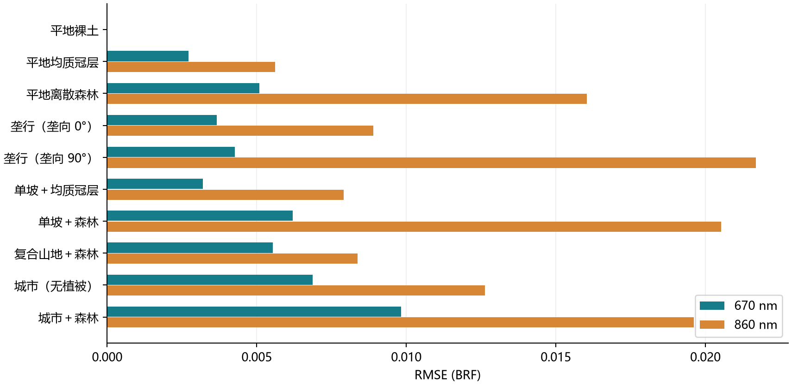

图 1　十个场景的红光与近红外 RMSE。

红光 RMSE 最大为城市＋森林（0.0098）；近红外 RMSE 最大为垄向 90° 作物（约 0.0217）。近红外最大逐方向误差为单坡＋森林的 0.084806，平均误差不能代替局部方向差异。

裸地误差在 1e-7 量级，保留科学计数法，避免将舍入后的零解释为严格一致。

## 2　平地裸土

均匀裸土基准；两波段土壤反射率分别为 0.18、0.30，用于检查无植被条件下的角度响应。

| 波段 | n | RMSE | 偏差 | 最大绝对误差 |
| --- | --- | --- | --- | --- |
| 670 nm | 61 | 2.16e-07 | -2.16e-07 | 2.16e-07 |
| 860 nm | 61 | 1.31e-07 | -1.31e-07 | 1.31e-07 |

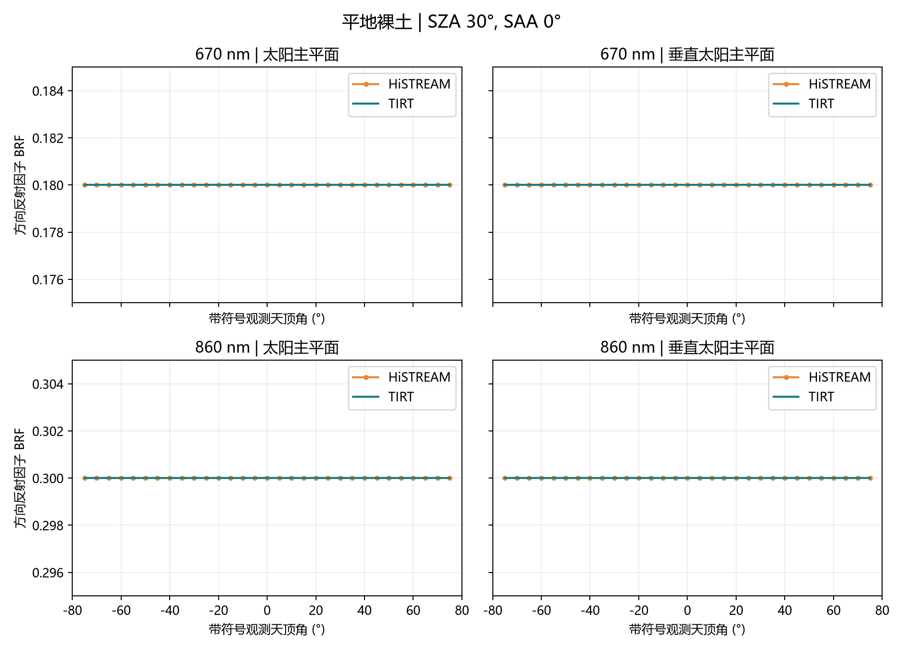

图 2　平地裸土：红光、近红外在两个主平面的 TIRT / HiSTREAM 对比。

每一波段的两个主平面采用相同纵轴范围。太阳主平面正角对应方位角 0°，负角对应 180°；垂直主平面正角对应 90°，负角对应 270°。天底在两幅图中均显示，统计时仅计一次。

此曲线对比针对所列输入和方向。未设置统一的物理精度通过阈值；1e-6 仅用于数值复算的一致性检查。

## 3　平地均质冠层

均质冠层 LAI 为 1.5。红光以吸收为主，近红外具有较强的叶片散射和透射。

| 波段 | n | RMSE | 偏差 | 最大绝对误差 |
| --- | --- | --- | --- | --- |
| 670 nm | 61 | 0.0027 | +0.0026 | 0.0046 |
| 860 nm | 61 | 0.0056 | -0.0022 | 0.0127 |

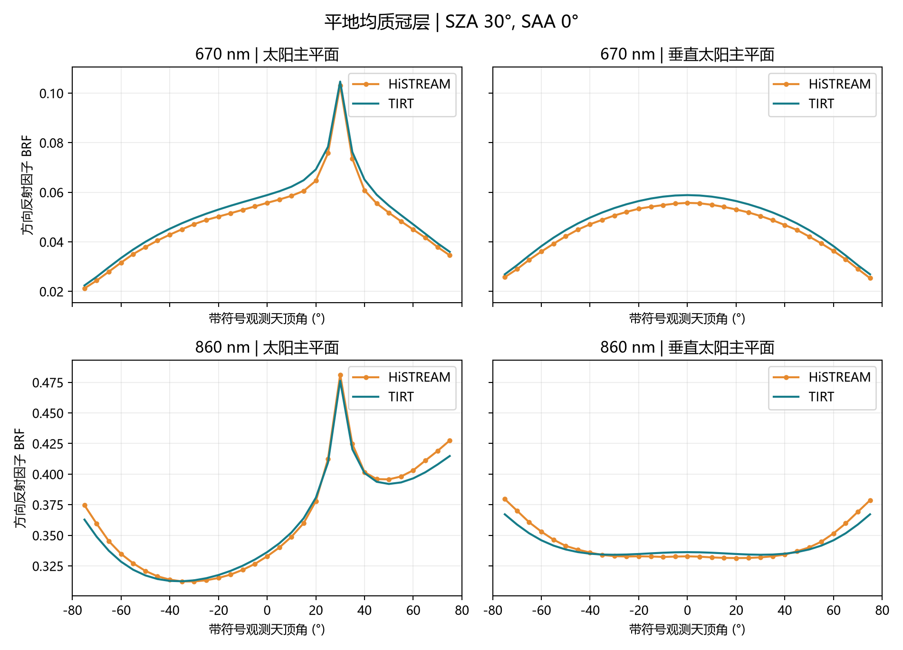

图 3　平地均质冠层：红光、近红外在两个主平面的 TIRT / HiSTREAM 对比。

每一波段的两个主平面采用相同纵轴范围。太阳主平面正角对应方位角 0°，负角对应 180°；垂直主平面正角对应 90°，负角对应 270°。天底在两幅图中均显示，统计时仅计一次。

此曲线对比针对所列输入和方向。未设置统一的物理精度通过阈值；1e-6 仅用于数值复算的一致性检查。

## 4　平地离散森林

离散森林采用 0.15 m 叶片尺度的参考场景；冠层 LAI 为 1.5。

| 波段 | n | RMSE | 偏差 | 最大绝对误差 |
| --- | --- | --- | --- | --- |
| 670 nm | 61 | 0.0051 | +0.0029 | 0.0082 |
| 860 nm | 61 | 0.0160 | -0.0144 | 0.0277 |

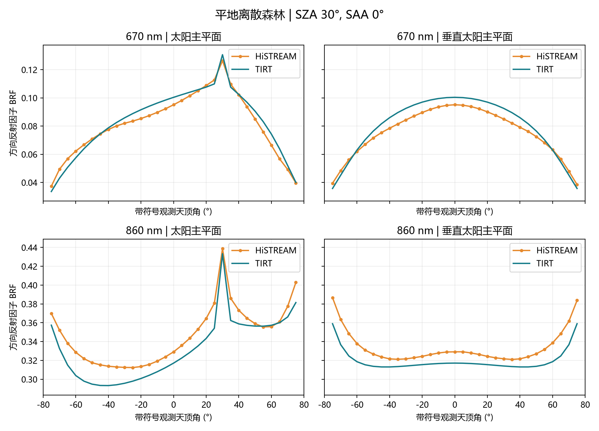

图 4　平地离散森林：红光、近红外在两个主平面的 TIRT / HiSTREAM 对比。

每一波段的两个主平面采用相同纵轴范围。太阳主平面正角对应方位角 0°，负角对应 180°；垂直主平面正角对应 90°，负角对应 270°。天底在两幅图中均显示，统计时仅计一次。

此曲线对比针对所列输入和方向。未设置统一的物理精度通过阈值；1e-6 仅用于数值复算的一致性检查。

## 5　垄行（垄向 0°）

垄宽 0.5 m、垄间空白 0.5 m、垄高 1 m，垄向为 0°。

| 波段 | n | RMSE | 偏差 | 最大绝对误差 |
| --- | --- | --- | --- | --- |
| 670 nm | 61 | 0.0037 | +0.0030 | 0.0097 |
| 860 nm | 61 | 0.0089 | +0.0053 | 0.0178 |

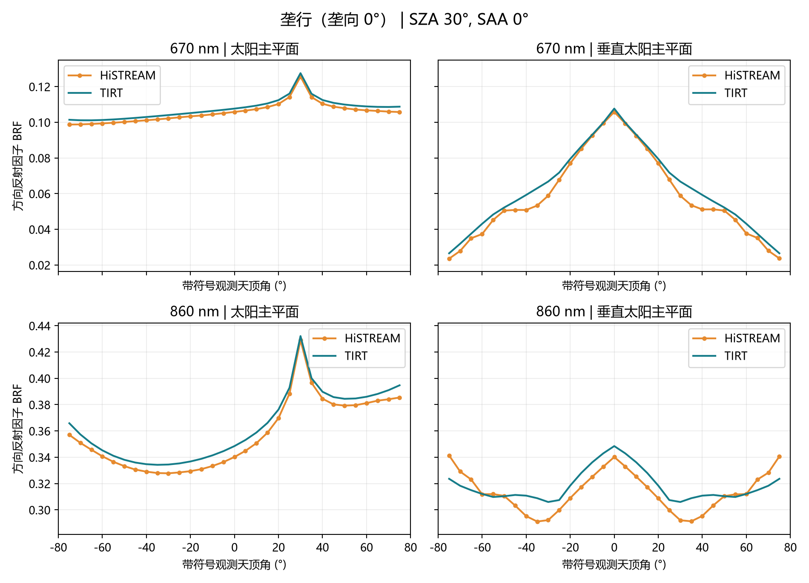

图 5　垄行（垄向 0°）：红光、近红外在两个主平面的 TIRT / HiSTREAM 对比。

每一波段的两个主平面采用相同纵轴范围。太阳主平面正角对应方位角 0°，负角对应 180°；垂直主平面正角对应 90°，负角对应 270°。天底在两幅图中均显示，统计时仅计一次。

此曲线对比针对所列输入和方向。未设置统一的物理精度通过阈值；1e-6 仅用于数值复算的一致性检查。

## 6　垄行（垄向 90°）

垄宽、垄间空白和垄高保持不变，垄向改为 90°；需同时查看两个观测主平面。

| 波段 | n | RMSE | 偏差 | 最大绝对误差 |
| --- | --- | --- | --- | --- |
| 670 nm | 61 | 0.0043 | +0.0030 | 0.0108 |
| 860 nm | 61 | 0.0217 | -0.0176 | 0.0386 |

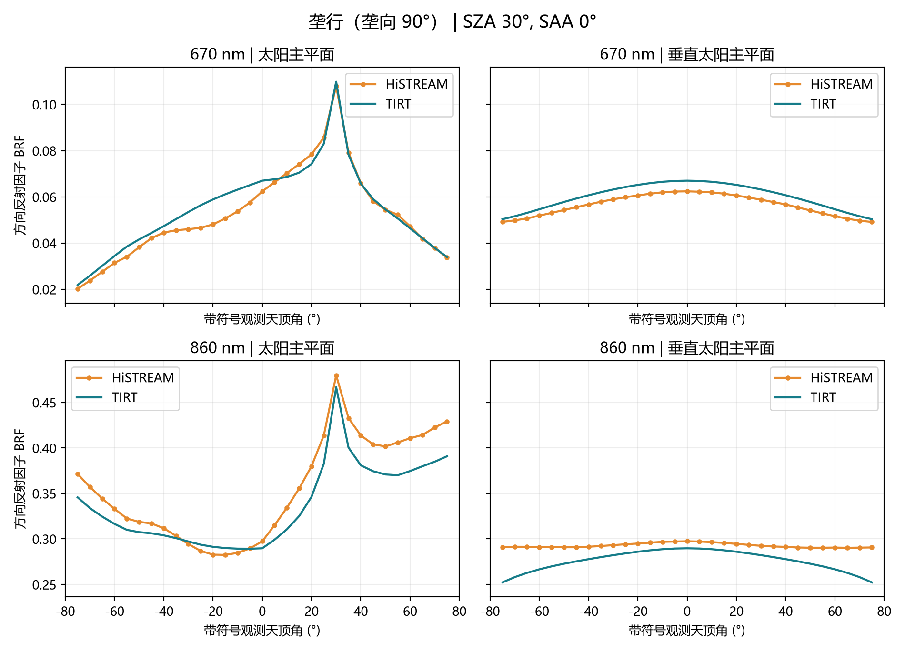

图 6　垄行（垄向 90°）：红光、近红外在两个主平面的 TIRT / HiSTREAM 对比。

每一波段的两个主平面采用相同纵轴范围。太阳主平面正角对应方位角 0°，负角对应 180°；垂直主平面正角对应 90°，负角对应 270°。天底在两幅图中均显示，统计时仅计一次。

此曲线对比针对所列输入和方向。未设置统一的物理精度通过阈值；1e-6 仅用于数值复算的一致性检查。

## 7　单坡＋均质冠层

30° 朝东单坡，上覆均质冠层。专用验证脚本先转换太阳和观测方向到坡面局地坐标，再调用平地光学模型。

| 波段 | n | RMSE | 偏差 | 最大绝对误差 |
| --- | --- | --- | --- | --- |
| 670 nm | 57 | 0.0032 | +0.0030 | 0.0061 |
| 860 nm | 57 | 0.0079 | -0.0055 | 0.0178 |

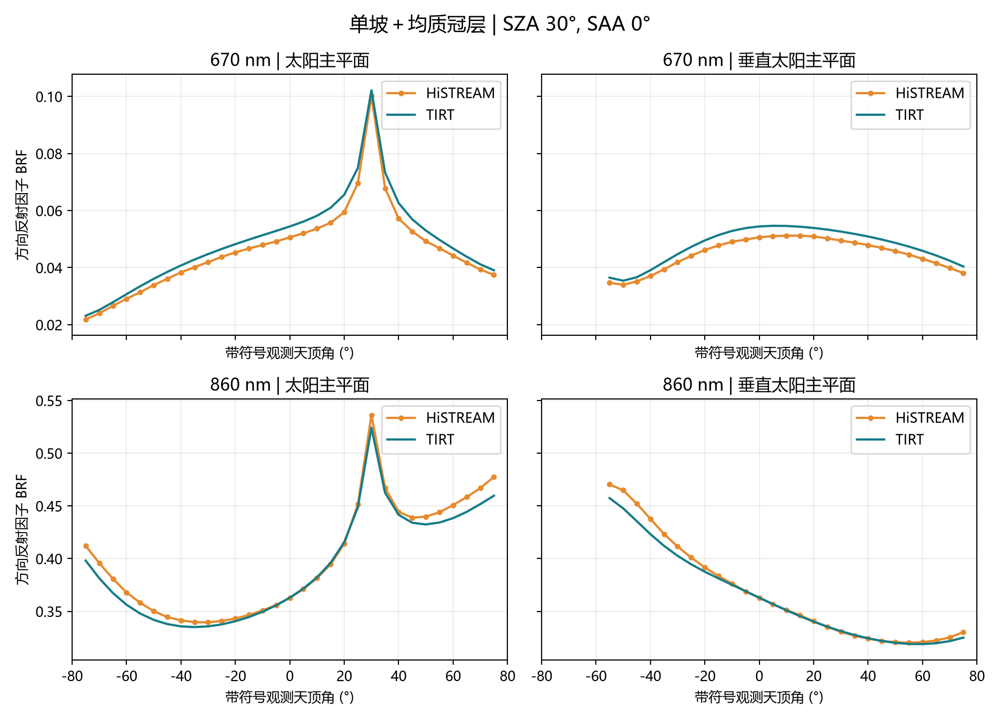

图 7　单坡＋均质冠层：红光、近红外在两个主平面的 TIRT / HiSTREAM 对比。

每一波段的两个主平面采用相同纵轴范围。太阳主平面正角对应方位角 0°，负角对应 180°；垂直主平面正角对应 90°，负角对应 270°。天底在两幅图中均显示，统计时仅计一次。

此曲线对比针对所列输入和方向。未设置统一的物理精度通过阈值；1e-6 仅用于数值复算的一致性检查。

## 8　单坡＋森林

30° 朝东单坡，上覆离散森林；同样采用局地角度转换，背坡观测不进入误差统计。

| 波段 | n | RMSE | 偏差 | 最大绝对误差 |
| --- | --- | --- | --- | --- |
| 670 nm | 57 | 0.0062 | +0.0040 | 0.0117 |
| 860 nm | 57 | 0.0205 | -0.0139 | 0.0848 |

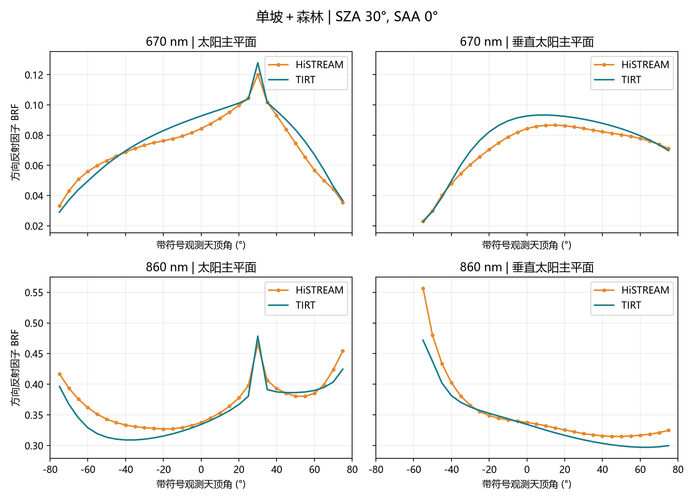

图 8　单坡＋森林：红光、近红外在两个主平面的 TIRT / HiSTREAM 对比。

每一波段的两个主平面采用相同纵轴范围。太阳主平面正角对应方位角 0°，负角对应 180°；垂直主平面正角对应 90°，负角对应 270°。天底在两幅图中均显示，统计时仅计一次。

此曲线对比针对所列输入和方向。未设置统一的物理精度通过阈值；1e-6 仅用于数值复算的一致性检查。

## 9　复合山地＋森林

复合山地与森林耦合场景，山高与底面半径均为 100 m。验证脚本调用底层 directional_reflectance；与热红外主页中的 20 m 山体不同。

| 波段 | n | RMSE | 偏差 | 最大绝对误差 |
| --- | --- | --- | --- | --- |
| 670 nm | 61 | 0.0055 | +0.0040 | 0.0103 |
| 860 nm | 61 | 0.0084 | -0.0060 | 0.0277 |

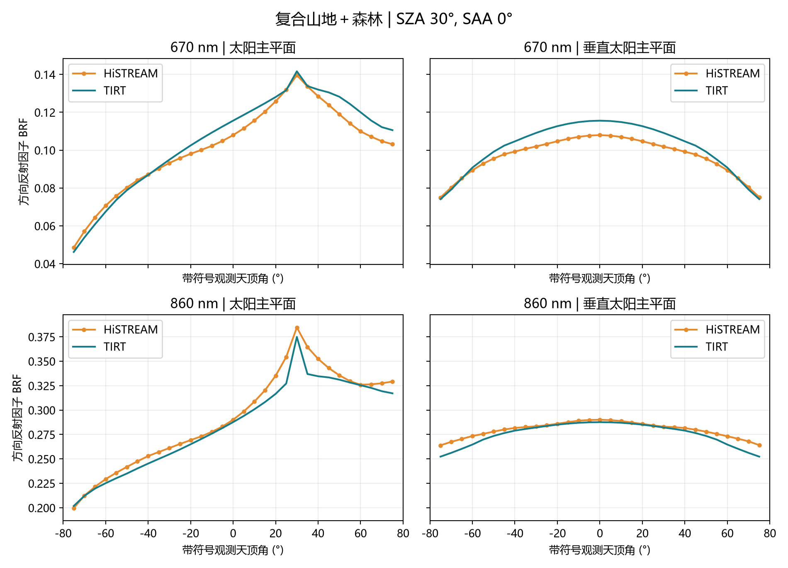

图 9　复合山地＋森林：红光、近红外在两个主平面的 TIRT / HiSTREAM 对比。

每一波段的两个主平面采用相同纵轴范围。太阳主平面正角对应方位角 0°，负角对应 180°；垂直主平面正角对应 90°，负角对应 270°。天底在两幅图中均显示，统计时仅计一次。

此曲线对比针对所列输入和方向。未设置统一的物理精度通过阈值；1e-6 仅用于数值复算的一致性检查。

## 10　城市（无植被）

建筑尺寸为 10 × 10 × 20 m，密度每平方米 0.0015 栋；街道不含植被。

| 波段 | n | RMSE | 偏差 | 最大绝对误差 |
| --- | --- | --- | --- | --- |
| 670 nm | 61 | 0.0069 | +0.0018 | 0.0217 |
| 860 nm | 61 | 0.0126 | +0.0056 | 0.0324 |

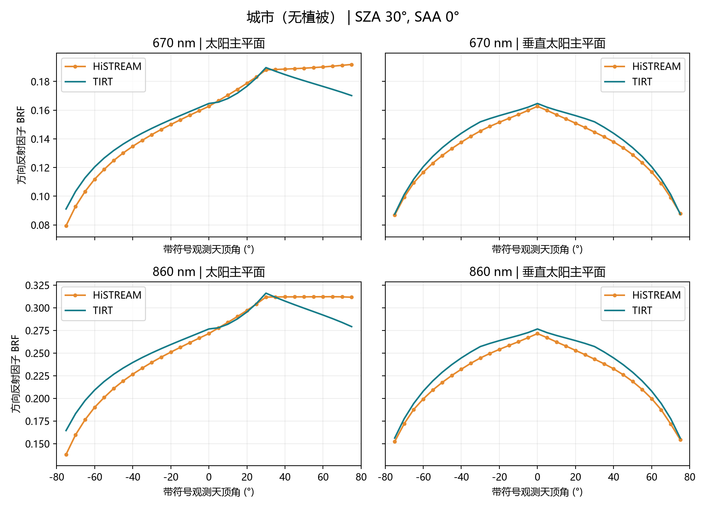

图 10　城市（无植被）：红光、近红外在两个主平面的 TIRT / HiSTREAM 对比。

每一波段的两个主平面采用相同纵轴范围。太阳主平面正角对应方位角 0°，负角对应 180°；垂直主平面正角对应 90°，负角对应 270°。天底在两幅图中均显示，统计时仅计一次。

此曲线对比针对所列输入和方向。未设置统一的物理精度通过阈值；1e-6 仅用于数值复算的一致性检查。

## 11　城市＋森林

城市建筑与街道森林耦合，叶片尺度 0.15 m；光学输入保留植被、街道、屋顶和墙面的独立材料参数。

| 波段 | n | RMSE | 偏差 | 最大绝对误差 |
| --- | --- | --- | --- | --- |
| 670 nm | 61 | 0.0098 | +0.0033 | 0.0297 |
| 860 nm | 61 | 0.0196 | -0.0135 | 0.0543 |

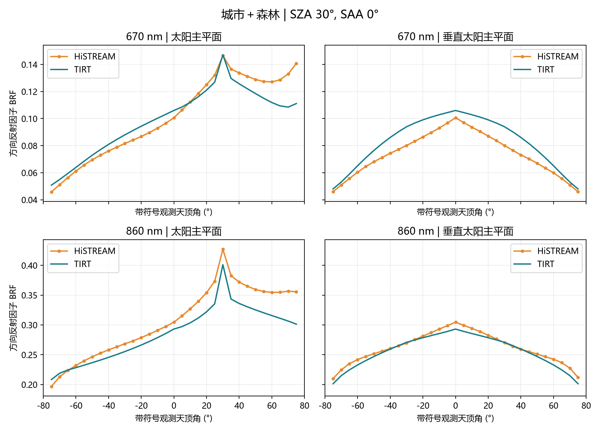

图 11　城市＋森林：红光、近红外在两个主平面的 TIRT / HiSTREAM 对比。

每一波段的两个主平面采用相同纵轴范围。太阳主平面正角对应方位角 0°，负角对应 180°；垂直主平面正角对应 90°，负角对应 270°。天底在两幅图中均显示，统计时仅计一次。

此曲线对比针对所列输入和方向。未设置统一的物理精度通过阈值；1e-6 仅用于数值复算的一致性检查。

## 12　多 LAI、多光谱与多角度示例

平地均质植被，LAI = 1、3、5，太阳天顶角 30°。使用 optical_run.py 的已保存运行输出；材料光谱为案例设定值。

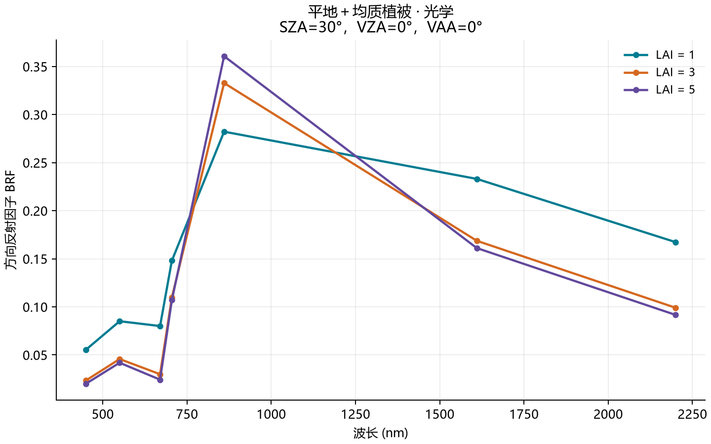

图 12　天底方向下的七波段 BRF，横坐标为波长。

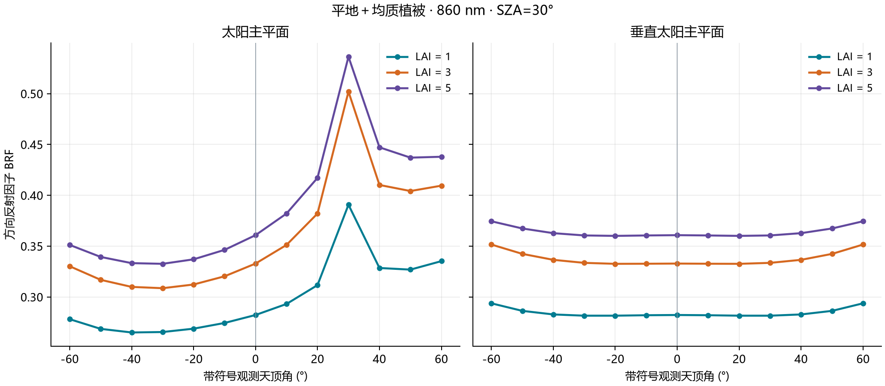

图 13　860 nm 的双主平面多角度 BRF，横坐标为观测天顶角。

七个示例波段为 450、550、670、705、860、1610、2200 nm；角度扫描为 -60° 至 60°。这些示例检验参数扫描与输出，只有 670、860 nm 另有本报告列出的参考模型对比。

## 13　运行覆盖、复现与适用范围

已有公开光学 JSON 入口测试共 10 个案例、858 条有效记录、20 张 PNG；每例保存 spectrum.csv、angles.csv 及两张图。以下为运行和输出完整性检查，不表示独立观测验证通过。

| 场景 | 有效记录 | PNG | 输出检查 |
| --- | --- | --- | --- |
| 平地裸土 | 33 | 2 | 通过 |
| 平地均质 | 99 | 2 | 通过 |
| 平地垄行 | 99 | 2 | 通过 |
| 平地森林 | 99 | 2 | 通过 |
| 单坡森林 | 99 | 2 | 通过 |
| 山地森林 | 99 | 2 | 通过 |
| 城市无植被 | 33 | 2 | 通过 |
| 城市均质植被 | 99 | 2 | 通过 |
| 城市垄行 | 99 | 2 | 通过 |
| 城市森林 | 99 | 2 | 通过 |

公开光学入口现已支持单坡 / 复合地形与裸土、均质、垄行的组合：坡面使用局地平面变换，复合地形使用组分比例。这些近似没有对应的独立验证，不能直接代表专用坡面/地形适配器的精度；单坡均质参考对比仍使用专用验证适配器。

### 证据与数值复现

独立报告数据位于 docs/validation/optical_report_20261024/，包含 1,204 条逐方向配对、20 行分场景统计、双波段总体统计、图件及 LAI 示例 CSV。source_manifest.json 记录源文件 SHA-256；编制时从配对数据重新核算 RMSE、偏差与最大误差。

原复算回执位于 report_20261024/verification.json：三波段联合复算采用绝对容差 1e-6、相对容差 0，最大差异 7.555229331e-9。该最大值包含热红外，本报告不将其误标为光学专属误差。

参考来源由 current_model_20261021/reference_manifest.json 记录，其中光学源文件为 github_optical_reference.csv。现有 reference_protocols.json 主要记录 10.5 μm 参数，不能据此宣称光学也采用相同采样数与追踪深度。本次没有新增光线追踪采样不确定性评估。

```powershell
python validation/validate_current_model.py --plots
python scripts/build_optical_validation_report.py --charts
python scripts/build_optical_validation_report.py --pdf
```

结论：本组光学结果覆盖 10 个典型结构场景的红光与近红外方向响应；城市森林、垄行及单坡森林仍需关注局部方向误差。研究来源：闻建光团队。

数据：[逐方向对比](validation/optical_report_20261024/reference_comparison.csv) · [精度统计](validation/optical_report_20261024/accuracy.csv) · [来源校验清单](validation/optical_report_20261024/source_manifest.json)
