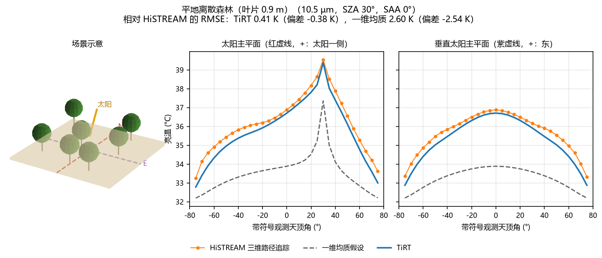
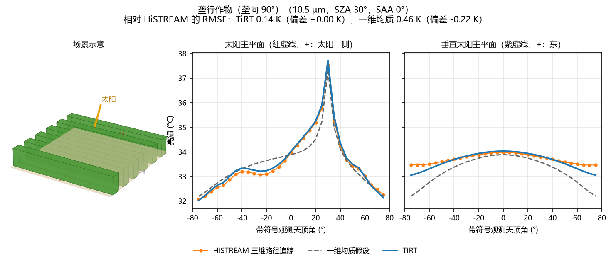
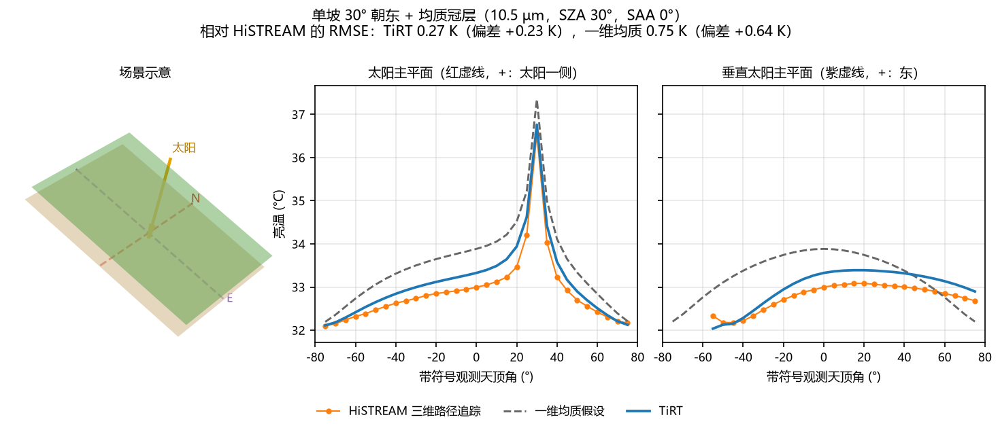
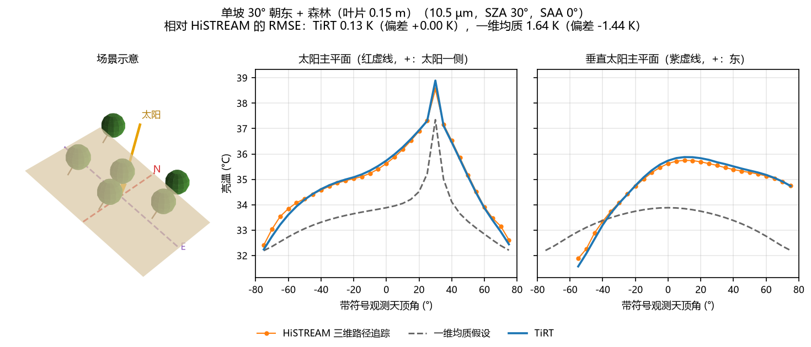

# TIRT 热红外辐射传输验证报告

依据 GitHub master 主页整理　｜　整理日期：2026-10-24

### 研究来源与报告依据

TIRT 热红外模型来自杜永明团队的相关研究工作。本报告整理 GitHub 主页“二、TiRT 角度验证（与 HiSTREAM 三维路径追踪对比）”的既有验证结果。

源版本为 master 提交 86c3829（2026-10-11）。原主页的 11 个场景、11 张对比图以及对应统计表均予以保留；本次工作为报告编排，未重新计算 TIRT 或 HiSTREAM。

### 验证目的

以 StreamSim 的 HiSTREAM 三维路径追踪（eRaytracing）结果为参考，检验 TIRT 对不同地表结构热红外方向亮温的描述能力。同时设置一维均质基准：采用同样的 LAI、发射率和组分温度，将地表视为平地、植被视为水平均质层，不描述坡面、地形、建筑及离散冠层结构。

### 统一试验条件

| 项目 | 条件 |
| --- | --- |
| 波段与输出 | 10.5 μm；评价量为方向亮温。图中单位 °C，误差单位 K。 |
| 太阳位置 | 太阳天顶角 30°、太阳方位角 0°。 |
| 观测方向 | 观测天顶角 0° 至 75°，步长 5°；太阳主平面及垂直太阳主平面。 |
| 参考计算 | HiSTREAM eRaytracing；512 × 512 平行投影，32 samples/pixel，depth = 4。 |
| 天空与大气 | 天空温度 3 K，天空反射近似为零；关闭大气。复算时显式设 `sky_temperature_k=none`（方向性 TiRT 当前默认 250 K）。 |
| 组分发射率 | 土壤/街道 0.955，叶片 0.985，屋顶 0.950，墙面 0.930；复合地形土壤 0.950。 |
| 组分温度 | 日照/阴影土壤、屋顶、墙面、街道为 318.15/303.15 K；叶片为 306.15/303.15 K。城市森林叶片统一为 304.65 K（31.5 °C）。 |

本组验证直接指定组分温度，评价热红外辐射传输的角度效应，不求解能量平衡。太阳位置用于确定日照与阴影状态。

来源主页：https://github.com/bianzj/tirt/tree/master

## 1　十一种场景的验证结果汇总

RMSE 和偏差均相对 HiSTREAM 计算。偏差 = 模型亮温 − HiSTREAM 亮温；RMSE 为差值平方均值的平方根。下表采用与主页配套的 overview.csv，保留三位小数，比主页正文两位小数的显示更完整。

| 场景 | n | TIRT RMSE / K | TIRT 偏差 / K | 一维均质 RMSE / K | 一维均质 偏差 / K |
| --- | --- | --- | --- | --- | --- |
| 平地裸土 | 64 | 0.000 | +0.000 | 0.000 | +0.000 |
| 平地均质冠层（LAI 1.5） | 64 | 0.203 | +0.170 | 0.203 | +0.170 |
| 平地离散森林（叶片 0.9 m） | 64 | 0.408 | -0.375 | 2.605 | -2.538 |
| 平地离散森林（叶片 0.15 m） | 64 | 0.149 | +0.031 | 2.111 | -2.031 |
| 垄行作物（垄向 0°） | 64 | 0.129 | +0.008 | 3.130 | -2.509 |
| 垄行作物（垄向 90°） | 64 | 0.137 | +0.000 | 0.463 | -0.222 |
| 单坡＋均质冠层 | 60 | 0.266 | +0.227 | 0.746 | +0.640 |
| 单坡＋森林 | 60 | 0.132 | +0.005 | 1.643 | -1.437 |
| 复合地形＋森林 | 64 | 0.165 | -0.068 | 2.273 | -2.242 |
| 城市（无植被） | 64 | 0.448 | -0.050 | 3.457 | +2.519 |
| 城市＋街道森林 | 64 | 0.628 | +0.470 | 3.002 | -2.397 |

n 为原 CSV 的有效统计记录数：通常为 64，两个单坡场景为 60，合计 696。保留原始方向记录及天底方位重复记录的统计口径，不作去重或重算。

### 结果要点

平地裸土与均质冠层符合一维均质假设，TIRT 与该基准结果相同。其余九个结构场景中，TIRT 的 RMSE 均低于一维均质基准，表明对冠层、垄行、坡面、地形及建筑结构的表示在这些测试条件下改善了方向亮温计算。

TIRT 的场景 RMSE 范围为 0.000 至 0.628 K（按 CSV 显示精度）；一维均质基准为 0.000 至 3.457 K。TIRT 最大 RMSE 出现在城市＋街道森林，最大逐方向绝对误差为城市无植被场景的 1.753 K。

后续各图均为 GitHub 原图：从左到右依次为场景示意、太阳主平面和垂直太阳主平面；橙色圆点线为 HiSTREAM、灰色虚线为一维均质基准、蓝线为 TIRT。同一张图的两个主平面使用相同纵轴范围。

## 2　逐场景验证图（1—2）

### 01　平地裸土

背景为均匀裸土，无冠层和其他三维结构。TIRT 与一维均质基准在该场景重合；RMSE 在原始统计表的三位小数精度下为 0.000 K，最大绝对误差为 0.001 K。

图 1　平地裸土：场景示意及两个主平面的方向亮温。

### 02　平地均质冠层（LAI 1.5）

冠层 LAI 为 1.5，均匀分布于 0 至 1 m 的层内，叶片尺度为 0.15 m。该场景符合水平均质假设，因此 TIRT 与一维均质基准一致，均为 RMSE 0.203 K、偏差 +0.170 K。

图 2　平地均质冠层（LAI 1.5）：场景示意及两个主平面的方向亮温。

## 3　逐场景验证图（3—4）

### 03　平地离散森林（叶片 0.9 m）

场景由随机分布的球形树冠构成，树冠半径 3 m、中心高度 6 m，离散叶片尺度为 0.9 m。TIRT 的 RMSE 为 0.408 K；一维均质基准为 2.605 K，并明显低估方向亮温。

图 3　平地离散森林（叶片 0.9 m）：场景示意及两个主平面的方向亮温。

### 04　平地离散森林（叶片 0.15 m）

采用 0.15 m 离散叶片的森林测试。TIRT 的 RMSE 为 0.149 K、偏差 +0.031 K；一维均质基准的 RMSE 为 2.111 K。两个森林测试分别保留，反映原主页的叶片尺度设置。

图 4　平地离散森林（叶片 0.15 m）：场景示意及两个主平面的方向亮温。

## 4　逐场景验证图（5—6）

### 05　垄行作物（垄向 0°）

垄宽 0.5 m、垄间空白 0.5 m、垄高 1 m，垄向为 0°。TIRT 能较好表示两个主平面的方向差异；RMSE 为 0.129 K，一维均质基准为 3.130 K。

图 5　垄行作物（垄向 0°）：场景示意及两个主平面的方向亮温。

### 06　垄行作物（垄向 90°）

垄向改为 90°，其他基本垄行尺寸沿用原测试设置。TIRT 的 RMSE 为 0.137 K，一维均质基准为 0.463 K；该场景的一维基准误差低于垄向 0° 情形，但仍高于 TIRT。

图 6　垄行作物（垄向 90°）：场景示意及两个主平面的方向亮温。

## 5　逐场景验证图（7—8）

### 07　单坡＋均质冠层

坡度为 30°，坡向朝东；太阳和观测方向转换到坡面局部坐标。背坡方向被排除，原始统计保留 60 条记录。TIRT 的 RMSE 为 0.266 K，一维均质基准为 0.746 K。

图 7　单坡＋均质冠层：场景示意及两个主平面的方向亮温。

### 08　单坡＋森林

同为 30° 朝东坡面，上覆 0.15 m 叶片尺度的离散森林。TIRT 的 RMSE 为 0.132 K、偏差 +0.005 K；一维均质基准的 RMSE 为 1.643 K。

图 8　单坡＋森林：场景示意及两个主平面的方向亮温。

## 6　逐场景验证图（9—10）

### 09　复合地形＋森林

原测试使用高 20 m、底面半径 30 m 的圆锥山体及球形森林冠层；场景内为 54 个互不重叠山体。TIRT 的 RMSE 为 0.165 K，一维均质基准为 2.273 K。

图 9　复合地形＋森林：场景示意及两个主平面的方向亮温。

### 10　城市（无植被）

建筑尺寸为 10 × 10 × 20 m，密度为每平方米 0.0015 栋，街道为裸地背景。TIRT 的 RMSE 为 0.448 K、最大绝对误差为 1.753 K；一维均质基准的 RMSE 为 3.457 K。

图 10　城市（无植被）：场景示意及两个主平面的方向亮温。

## 7　城市森林验证与结论

### 11　城市＋街道森林

建筑之间布置街道森林，叶片尺度为 0.15 m，叶片温度统一为 31.5 °C。TIRT 的 RMSE 为 0.628 K、偏差 +0.470 K；一维均质基准的 RMSE 为 3.002 K。该场景是本组测试中 TIRT 的 RMSE 最大项。

图 11　城市＋街道森林：场景示意及两个主平面的方向亮温。

### 结论与适用范围

GitHub 主页的这组验证覆盖了从平地裸土、均质植被到离散森林、垄行、坡面、复合地形与城市耦合场景的热红外方向效应。TIRT 在九个结构场景中均较一维均质基准降低 RMSE；城市场景仍表现出较大的剩余误差，应作为后续改进重点。

这些结果对应指定太阳位置、单一热红外波段、固定材料和组分温度，属于模型间比较。不能据此给出独立地面观测精度，也不能直接代表其他版本或能量平衡温度求解的精度。

### 来源与数据保全

统计与图件均取自提交 86c3829a91ce4ccc4ff1c650b0b77cda4f316582。原始 README、overview.csv、11 张 PNG、场景说明与绘图脚本已保存于 docs/validation/github_master_20261011/，source_manifest.json 记录原 Git blob 标识和 SHA-256。

原图生成脚本为 benchmark/streamsim/overview_plot.py，其运行需要原始 benchmark/streamsim/runs/ 数据；该原始运行目录未入库。本次直接整理已发布统计表和图件，保持其原有数值。

来源：[GitHub 主页](https://github.com/bianzj/tirt/tree/master) · [固定版本主页](https://github.com/bianzj/tirt/blob/86c3829a91ce4ccc4ff1c650b0b77cda4f316582/README.md) · [原始统计 CSV](validation/github_master_20261011/overview.csv) · [来源校验清单](validation/github_master_20261011/source_manifest.json)
