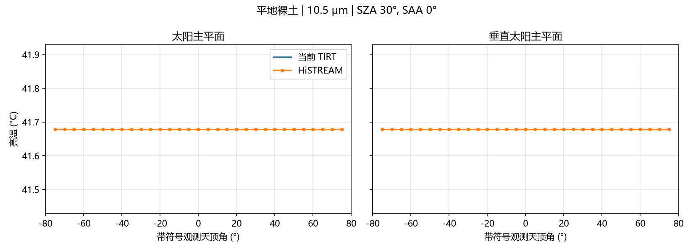
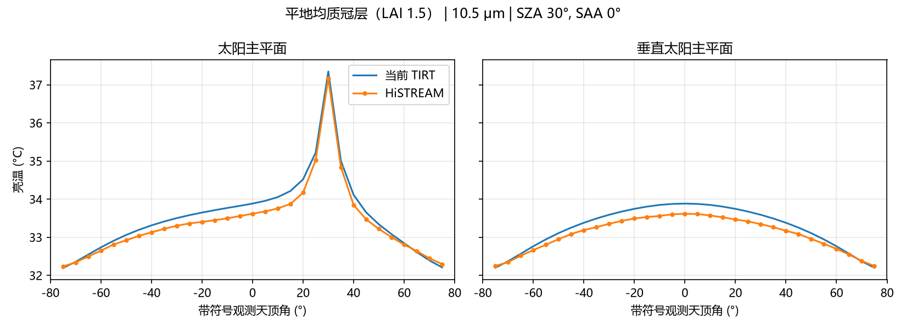
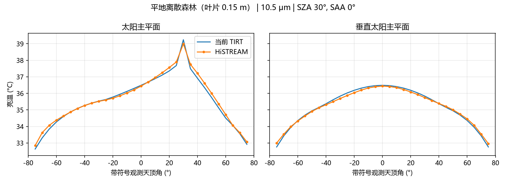
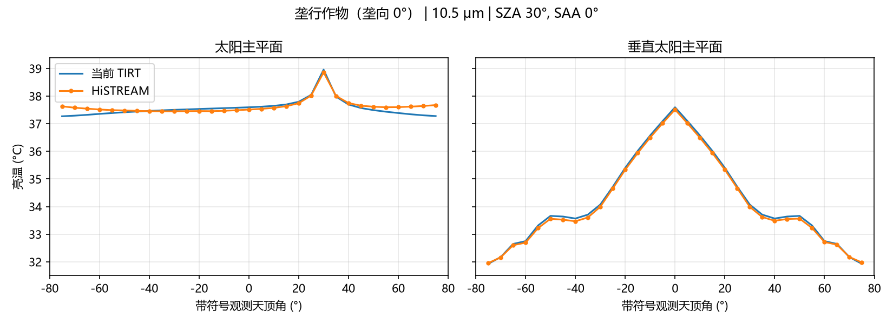
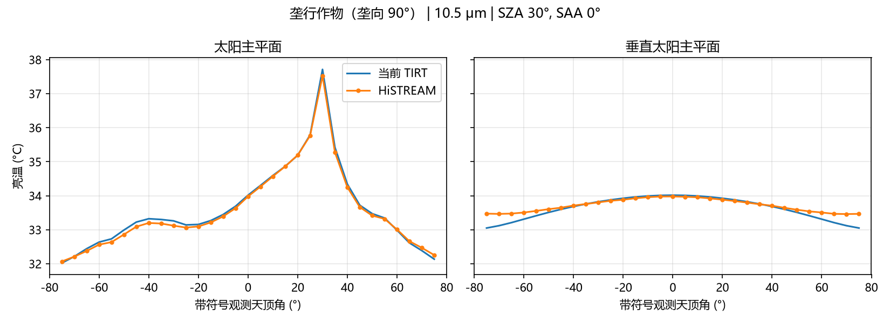
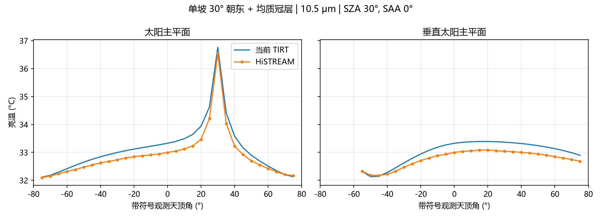
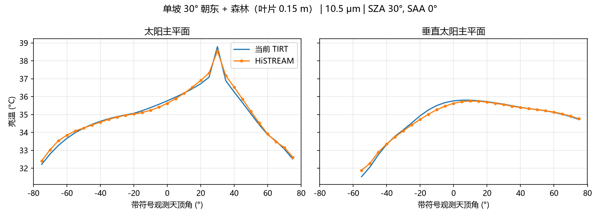
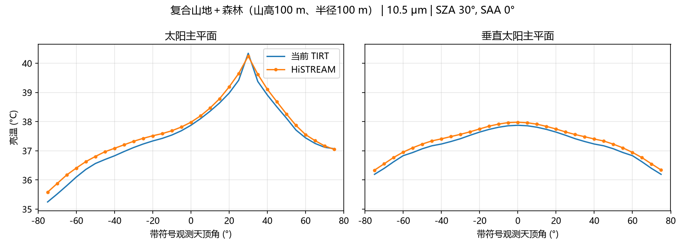
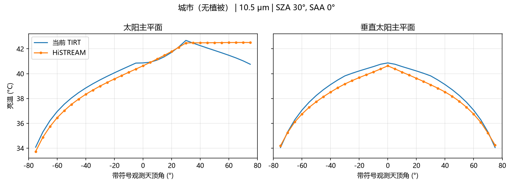
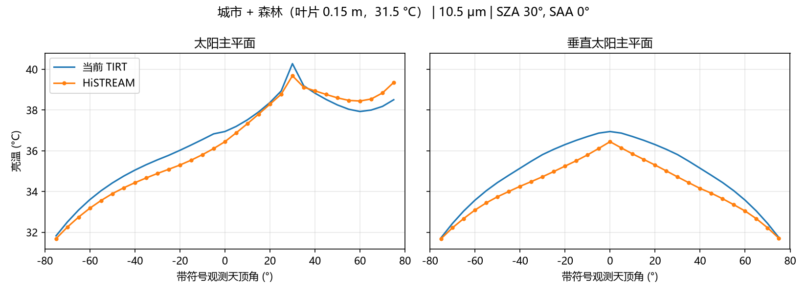

# TiRT 测试文档：与 HiSTREAM 三维路径追踪对比

TiRT 的方向结果与 HiSTREAM 三维路径追踪在 10 组场景下逐方向对比。TiRT 使用当前默认（参数化标准）分支，HiSTREAM 为冻结参考，未重新运行光线追踪。全部输入、逐方向结果、参考值和 30 张图在 [`validation/current_model_20261021/`](validation/current_model_20261021/)。

## 测试条件

- 太阳：天顶角 30°，方位角 0°。
- 观测：天顶角 0–75°（步长 5°），方位角 0/90/180/270°；天底只计一次，每波段 61 个方向。单坡场景有 4 个方向位于坡面背面，不参与统计（57 个）。
- 波段：10.5 μm 热红外（亮温，K）、670 nm 红光、860 nm 近红外（BRF）。
- 热红外：固定组分温度与发射率（土壤 0.955、叶片 0.985、地形 0.95、屋顶 0.95、墙 0.93、街道 0.955），黑天空。
- 光学：叶片 ρ = 0.06/0.45、τ = 0.03/0.42，土壤 ρ = 0.18/0.30，屋顶 ρ = 0.22/0.35，墙 ρ = 0.30/0.45（红光/近红外）；太阳直射照明。

| 场景 | 设置 |
|---|---|
| 平地裸土 | 均匀土壤 |
| 平地均质冠层 | LAI 1.5 |
| 平地离散森林 | 球冠半轴 3 m，叶片 0.15 m（hspot 0.025） |
| 垄行（垄向 0° / 90°） | 垄宽 0.5 m、垄距 0.5 m、垄高 1 m |
| 单坡 + 均质冠层 / 森林 | 坡度 30°，坡向朝东 |
| 复合山地 + 森林 | 山高 100 m、半径 100 m，球冠半轴 2 m |
| 城市（无植被） | 建筑 10 × 10 × 20 m，密度 0.0015 m⁻² |
| 城市 + 森林 | 同上，街道森林 31.5 °C |

## 热红外结果（10.5 μm，K）

| 场景 | n | RMSE | 偏差 | 最大误差 |
|---|---|---|---|---|
| 平地裸土 | 61 | 0.000 | +0.000 | 0.000 |
| 平地均质冠层 | 61 | 0.198 | +0.164 | 0.350 |
| 平地离散森林 | 61 | 0.138 | −0.034 | 0.318 |
| 垄行（垄向 0°） | 61 | 0.128 | +0.001 | 0.399 |
| 垄行（垄向 90°） | 61 | 0.134 | −0.017 | 0.423 |
| 单坡 + 均质冠层 | 57 | 0.260 | +0.226 | 0.472 |
| 单坡 + 森林 | 57 | 0.140 | −0.019 | 0.359 |
| 复合山地 + 森林 | 61 | 0.178 | −0.160 | 0.369 |
| 城市（无植被） | 61 | 0.567 | +0.204 | 1.750 |
| 城市 + 森林 | 61 | 0.670 | +0.472 | 1.095 |

## 光学结果（BRF，RMSE）

| 场景 | 670 nm | 860 nm |
|---|---|---|
| 平地裸土 | 0.0000 | 0.0000 |
| 平地均质冠层 | 0.0027 | 0.0056 |
| 平地离散森林 | 0.0051 | 0.0160 |
| 垄行（垄向 0°） | 0.0037 | 0.0089 |
| 垄行（垄向 90°） | 0.0043 | 0.0217 |
| 单坡 + 均质冠层 | 0.0032 | 0.0079 |
| 单坡 + 森林 | 0.0062 | 0.0205 |
| 复合山地 + 森林 | 0.0055 | 0.0084 |
| 城市（无植被） | 0.0069 | 0.0126 |
| 城市 + 森林 | 0.0098 | 0.0196 |

## 热红外对比图

每张图左为太阳主平面（正角度为太阳一侧），右为垂直太阳主平面；蓝线为 TiRT，橙色点为 HiSTREAM。红光、近红外图在同一目录（文件名后缀 `_670`、`_860`）。












## 说明与局限

- 只有一个太阳位置、一个热红外波段、每类场景一组结构参数，属于单点对比。
- 单坡参考是“平地场景 + 局地太阳角”，与模型同样假设冠层垂直于坡面。
- 城市场景误差最大：城市建筑核（墙—街交换按观测方位拆分的近似）和均质冠层不在本次参数化范围内。

## 复现

```powershell
python scripts/validate_current_model.py --plots
```

脚本用包内输入重算 1830 条波段—方向记录，与包内结果逐条比对（容差 1e-10），并校验输入和参考的 SHA256。
