# TiRT / TIRTEB 测试报告

本报告给出当前标准版（`canopy_closure=standard`）的两组测试结果：

1. TiRT 方向辐射与 HiSTREAM 光线追踪的对比（10 个场景，0.67 µm、0.86 µm、10.5 µm）；
2. TIRTEB 能量平衡与 SCOPE 1.73 验证算例的对比，重点是组分温度的日变化。

所用公式见《TiRT / TIRTEB 理论与方法说明》。所有结果都可由仓库中的脚本复算，见第 4 节。

## 1 TiRT 与 HiSTREAM

### 1.1 测试设置

HiSTREAM 参考值是预先计算并保存的光线追踪结果（每像元 32 个样本、最多 4 次散射、512×512 像元），本报告不重新运行 HiSTREAM。TiRT 在相同输入下逐方向重新计算，与参考值配对比较。

- 太阳天顶角 30°、方位 0°；短波为纯直射，热红外为黑天空下的地表自身发射。
- 观测方向：太阳主平面和垂直主平面，天顶角 0–75°、间隔 5°，每个波段 61 个方向；单坡场景中背坡不可见的 4 个方向不参与比较（57 个）。
- 叶片反射率/透过率：0.67 µm 为 0.06/0.03，0.86 µm 为 0.45/0.42；土壤反射率 0.18/0.30。
- 热红外发射率：叶片 0.985、土壤 0.955；组分温度：光照/阴影土壤 45/30 °C，光照/阴影叶片 33/30 °C；城市屋顶、墙面、街道光照面 45 °C。
- 植被：LAI 1.5；均质 hspot 0.15；树冠水平半径与垂直半轴 3 m，冠底高 3 m，密度 0.02 株/m²，hspot 0.025；垄行宽 0.5 m、间距 0.5 m、高 1 m。

| 场景 | 地表 | 植被 | 关键参数 |
|---|---|---|---|
| 平地裸土 | 平面 | 裸土 | — |
| 平地均质冠层 | 平面 | 均质 | LAI 1.5 |
| 平地离散森林 | 平面 | 树冠 | 叶片 0.15 m |
| 垄行 0° / 90° | 平面 | 垄行 | 垄向 0°、90° |
| 单坡均质 / 单坡森林 | 单坡 | 均质、树冠 | 坡度 30°、朝东 |
| 复合山地森林 | 复合地形 | 树冠 | 山高 100 m、半径 100 m，树冠半径 2 m |
| 城市裸地 / 城市森林 | 城市 | 无、树冠 | 建筑 10×10×20 m，密度 0.0015 |

### 1.2 总体精度

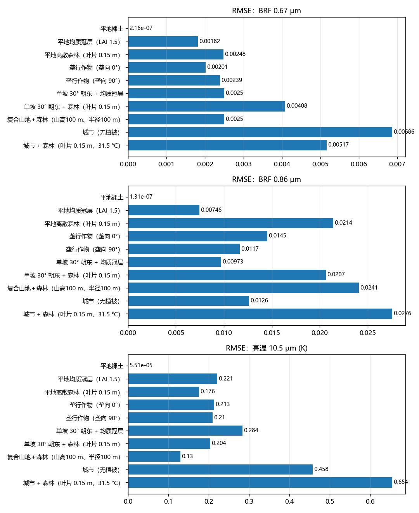

| 场景 | 0.67 µm RMSE（偏差） | 0.86 µm RMSE（偏差） | 10.5 µm RMSE（偏差），K |
|---|---|---|---|
| 平地裸土 | 2.2e-7 | 1.3e-7 | 0.0001 |
| 平地均质冠层 | 0.0018（+0.0016） | 0.0075（+0.0066） | 0.221（+0.194） |
| 平地离散森林 | 0.0025（−0.0004） | 0.0214（−0.0204） | 0.176（+0.051） |
| 垄行 0° | 0.0020（+0.0010） | 0.0145（+0.0075） | 0.213（+0.119） |
| 垄行 90° | 0.0024（−0.0003） | 0.0117（+0.0014） | 0.210（−0.0005） |
| 单坡均质 | 0.0025（+0.0022） | 0.0097（+0.0087） | 0.284（+0.256） |
| 单坡森林 | 0.0041（+0.0013） | 0.0207（−0.0182） | 0.204（+0.085） |
| 复合山地森林 | 0.0025（−0.0018） | 0.0241（−0.0222） | 0.130（−0.075） |
| 城市裸地 | 0.0069（+0.0018） | 0.0126（+0.0056） | 0.458（+0.115） |
| 城市森林 | 0.0052（+0.0024） | 0.0276（−0.0260） | 0.654（+0.529） |

偏差为 TiRT − HiSTREAM 的方向平均。

- **热红外**：植被场景 RMSE 0.13–0.28 K，城市裸地 0.46 K，城市森林 0.65 K。热点位置和峰值与 HiSTREAM 一致。
- **红光（0.67 µm）**：除城市外 RMSE 都在 0.0018–0.0041 之间。红光以一次散射为主，说明四组分可见比例（光照/阴影土壤与叶片）和热点几何是准确的。
- **近红外（0.86 µm）**：均质、垄行和单坡均质为 0.0075–0.0145；含树冠的场景为 0.021–0.028，且一致偏低约 0.02。

### 1.3 主要偏差

1. **树冠场景近红外偏低约 0.02**。分解平地离散森林的 BRF：红光的多次散射只占 2%，偏差 −0.0004；近红外的多次散射占 42%，偏差 −0.020。偏差约 30% 来自光照叶片比例（覆盖相双层近似在热点以外偏小，天底为 0.168），约 70% 来自多次散射（树冠的节点方案只有一个冠层节点和一个土壤节点）。
2. **城市森林热红外整体偏高约 0.5 K**；城市裸地在主平面热点之后（+40° 至 +75°）TiRT 下降而 HiSTREAM 基本持平。
3. **均质和单坡均质热红外偏高约 0.2–0.26 K**，主要在背向太阳一侧和垂直主平面，热点附近吻合。

### 1.4 各场景方向曲线

以下各图中，橙色为 HiSTREAM，蓝色为 TiRT；左列为太阳主平面，右列为垂直主平面，横轴正值为太阳一侧。

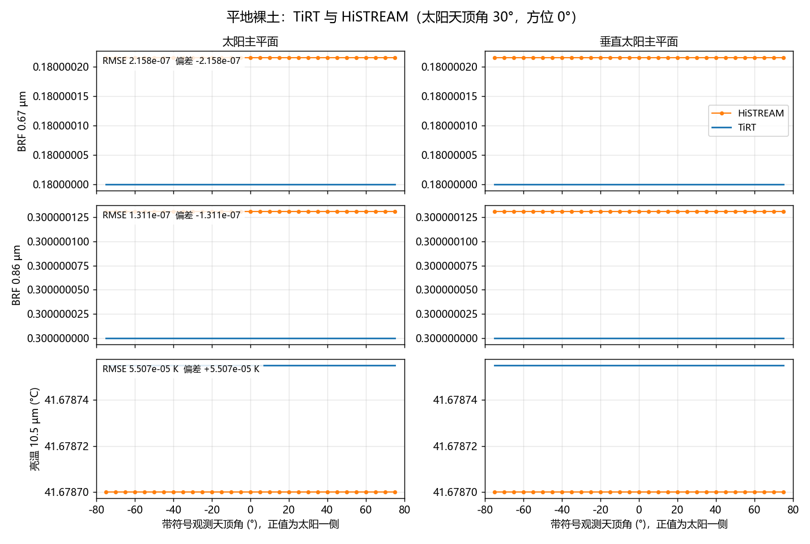

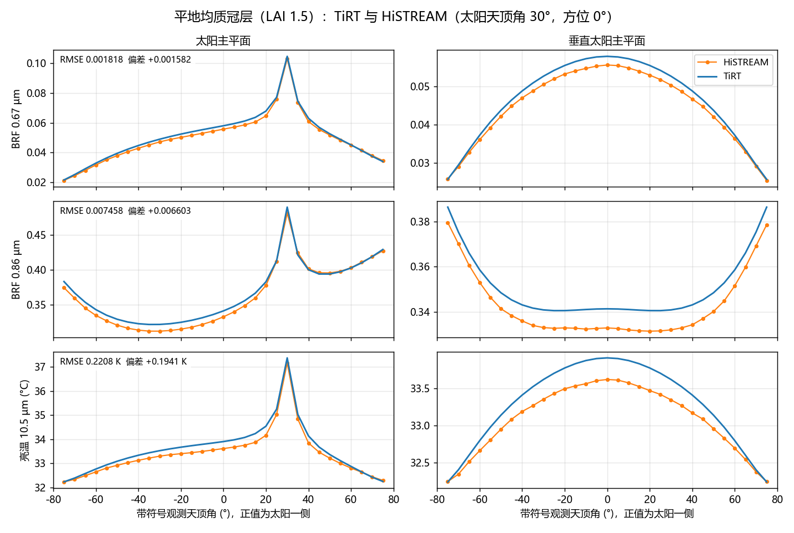

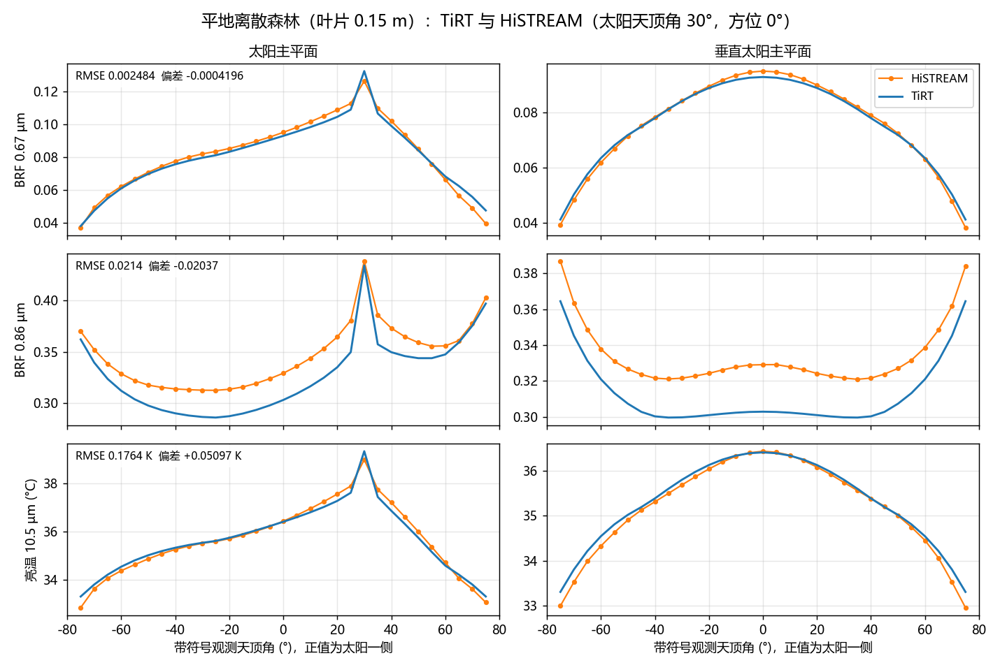

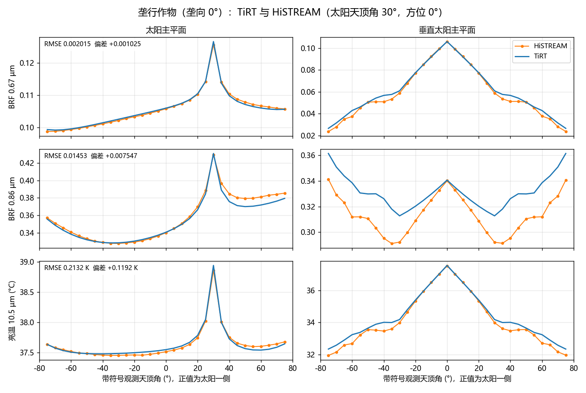

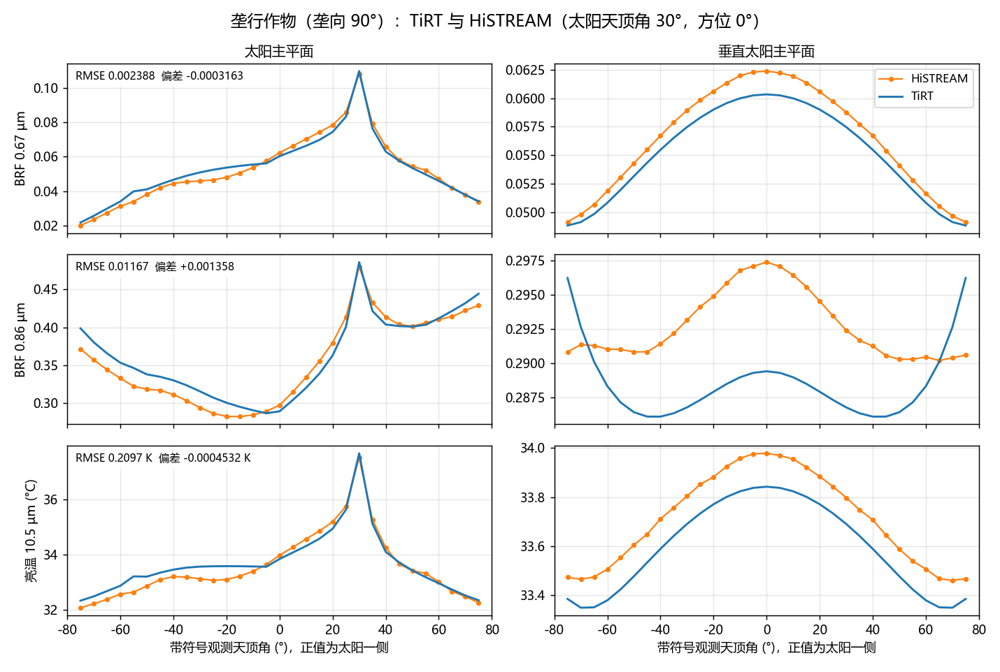

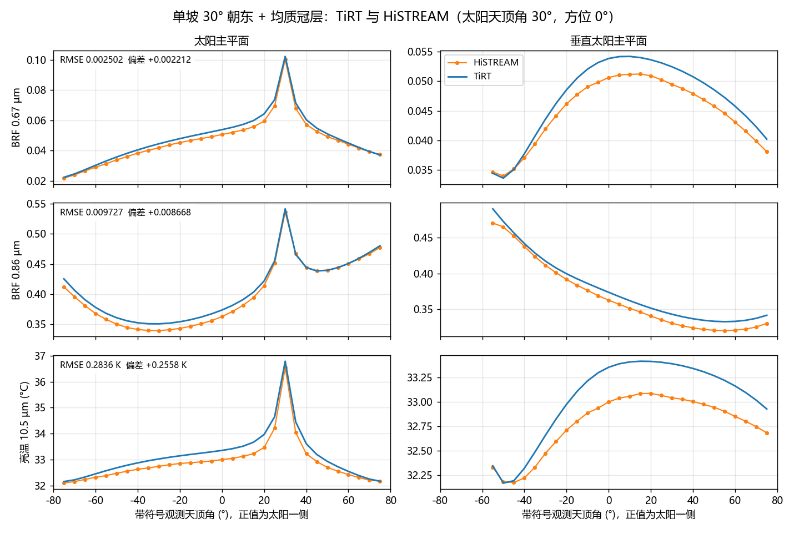

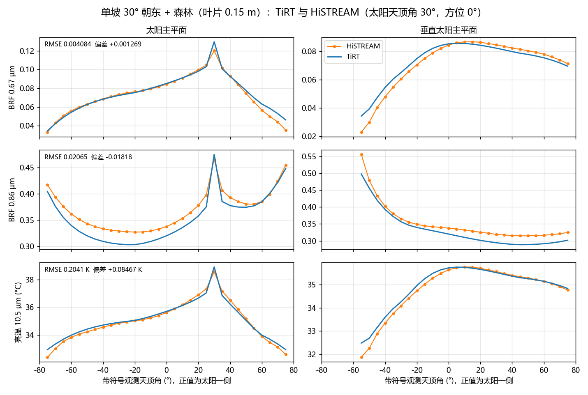

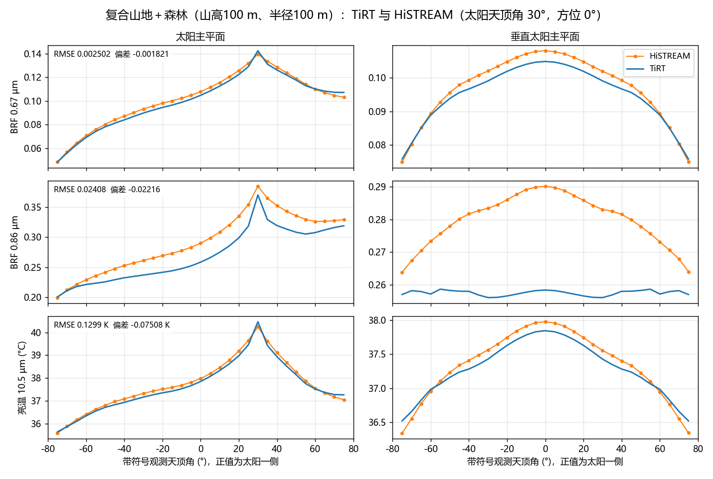

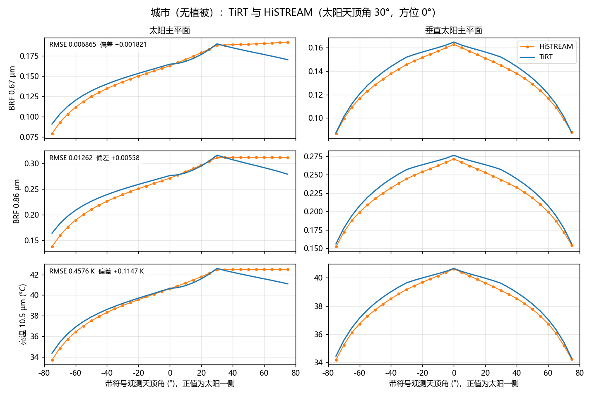

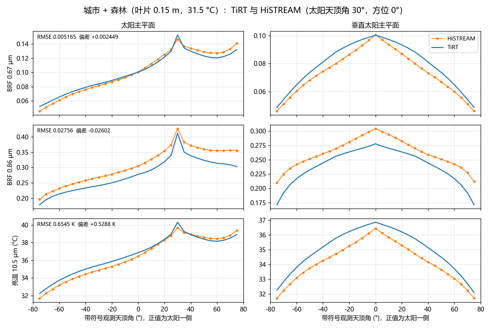

## 2 TIRTEB 与 SCOPE 1.73

### 2.1 测试设置

参考数据为 SCOPE 1.73 自带的验证算例输出（`output/verificationdata`），本报告不重新运行 SCOPE。TIRTEB 使用相同的输入驱动：

- 平地均质冠层，LAI 3；DOY 169，半小时一步，共 49 步（24 h）；
- 气象（气温、水汽压、气压、风速、入射短波和长波）、站点经纬度和时区、冠层高度、叶宽、叶片生化参数（Vcmax、Ball–Berry 斜率等）、土壤热参数和阻抗参数都取自 SCOPE 的 `pars_and_input.dat`；
- 热红外叶片和土壤的反射率/透过率取 SCOPE 的 `rho_thermal`、`tau_thermal`、`rs_thermal`；
- 气孔采用 Farquhar 方案，最小导度取 SCOPE 的 BallBerry0；土壤热通量用表层方案（`soil_heat_method=surface`）。

比较量为 SCOPE 输出的光照/阴影土壤温度、平均土壤温度、冠层平均温度、天底 10.5 µm 亮温，以及净辐射、潜热、感热、土壤热通量。

### 2.2 温度的日变化

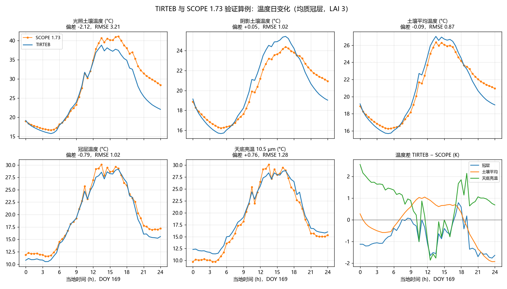

| 温度 | 全天偏差 / RMSE（K） | 白天偏差 / RMSE | 夜间偏差 / RMSE | SCOPE 日均 / TIRTEB 日均（°C） |
|---|---|---|---|---|
| 冠层温度 | −0.79 / 1.02 | −0.52 / 0.80 | −1.34 / 1.37 | 20.01 / 19.22 |
| 土壤平均温度 | −0.09 / 0.87 | +0.31 / 0.68 | −0.91 / 1.18 | 20.95 / 20.86 |
| 阴影土壤温度 | +0.05 / 1.02 | +0.51 / 0.93 | −0.91 / 1.18 | 20.21 / 20.26 |
| 光照土壤温度 | −2.12 / 3.21 | −1.67 / 2.56 | −3.06 / 4.25 | 28.47 / 26.35 |
| 天底亮温 10.5 µm | +0.76 / 1.28 | +0.42 / 1.13 | +1.46 / 1.56 | 18.76 / 19.52 |

白天为入射短波大于 0 的 33 步，夜间为其余 16 步。

- **冠层温度**的日变化形状、峰值时刻和幅度与 SCOPE 一致，全天 RMSE 1.0 K。白天偏低约 0.5 K，夜间偏低约 1.3 K。
- **土壤平均温度** RMSE 0.87 K。午后 TIRTEB 高约 1 K，入夜后 TIRTEB 降温更快，24 时低约 1.9 K。
- **光照土壤温度**白天峰值 TIRTEB 约 38 °C，SCOPE 约 41 °C。日落后两个模型的“光照土壤”都保留各自的热历史缓慢冷却，TIRTEB 冷却更快（24 时 22.0 °C，SCOPE 28.4 °C），这是夜间偏差 −3 K 的来源。
- **天底亮温**白天偏差 +0.4 K，夜间 +1.5 K。夜间冠层温度偏低而亮温偏高，说明差别出在方向发射与天空长波反射的处理上，而不是组分温度；两者的具体分摊本报告未作分离。

### 2.3 能量通量

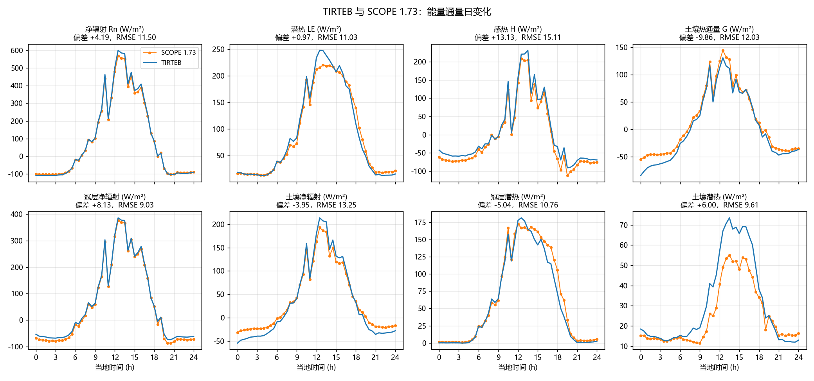

| 通量（W/m²） | 全天偏差 | 全天 RMSE | SCOPE 日均 | TIRTEB 日均 |
|---|---|---|---|---|
| 净辐射 Rn | +4.2 | 11.5 | 92.0 | 96.2 |
| 潜热 LE | +1.0 | 11.0 | 89.6 | 90.6 |
| 感热 H | +13.1 | 15.1 | −10.7 | 2.5 |
| 土壤热通量 G | −9.9 | 12.0 | 13.0 | 3.1 |

净辐射和潜热与 SCOPE 吻合，日均差约 1–4 W/m²。感热偏高约 13 W/m²，夜间尤其明显（TIRTEB −60，SCOPE −72）；土壤热通量夜间更负。主要原因是夜间湍流交换的处理不同：SCOPE 1.73 只在 L > 4000 m 时使用稳定修正，同时把 L 限制在 100 m 以内，因此夜间实际按中性层结计算；TIRTEB 使用 Monin–Obukhov 稳定修正，并把每段气动阻抗限制在 400 s/m。

## 3 物理一致性检查与已知限制

除与参考模型的比较外，测试集还检查以下物理约束（`tests/`，172 项通过、6 项预期失败）：

- TiRT 与 TIRTEB 方向观测一致：16 个场景、相同组分温度下逐方向比较，最大差 2e-16；
- 冻结基准的严格复现：1806 个方向的预测值与基准的最大差 6e-14；
- 能量平衡闭合：五天连续算例 240 步全部闭合，最大组件残差 1e-4 W/m²；
- 裸地地形短波随几何变化（修复前恒为土壤反射率），全散射天空时回到土壤反照率；
- 短波与热红外读取同一套地形锥体参数（含分号多层写法）。

本轮修复裸地地形短波、地形参数解析与裸地地形热红外直射几何。上面十场景的 HiSTREAM 对比结果不受影响：修复后逐点复现差仍为 6e-14，精度表与本报告第 1 节一致。

下列已知限制在测试中标为预期失败（6 项，属闭合方案的固有性质），修复后会提示：

| 限制 | 量级 |
|---|---|
| 光照叶片的覆盖相双层近似不满足太阳/观测互易 | LAI 2、太阳 40° 与观测 70° 对调：均质 0.378/0.434 |
| 直射下方向反射率的半球积分高于节点吸收预算 | 近红外、LAI 2：高 0.016–0.033 |
| 单坡近地平线时 BRF 不随入射余弦线性衰减 | BRF/cos i 在最后 0.1° 内从 49 升到 3115 |

TIRTEB 的能量平衡使用节点吸收预算，不受第二项影响。

## 4 复算方法

| 内容 | 命令 |
|---|---|
| TiRT 与 HiSTREAM 对比 | `python validation/validate_current_model.py --plots` |
| TIRTEB 与 SCOPE 1.73 对比 | `python validation/scope/compare_scope.py` |
| TiRT 与 TIRTEB 一致性 | `python validation/compare_tirt_tirteb.py --full` |
| 全部测试 | `python -m pytest tests` |
| 本报告的图 | `python docs/report/make_figures.py` |
