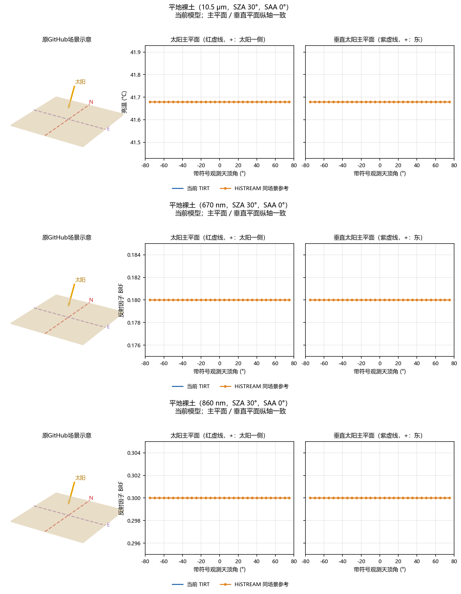
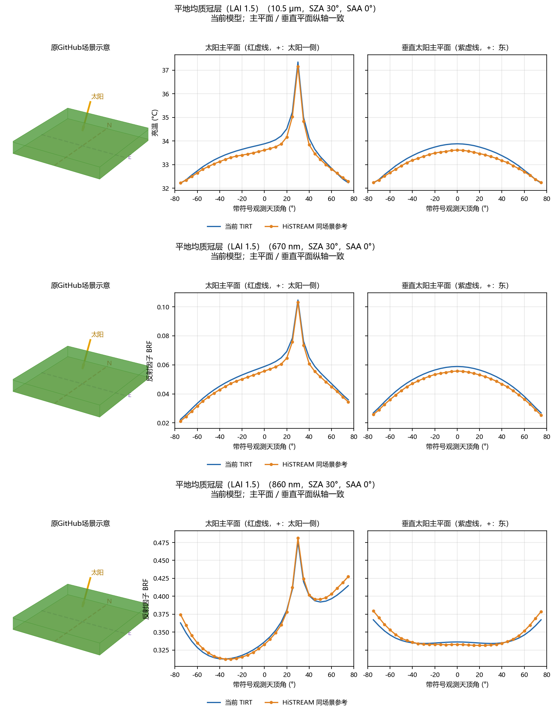
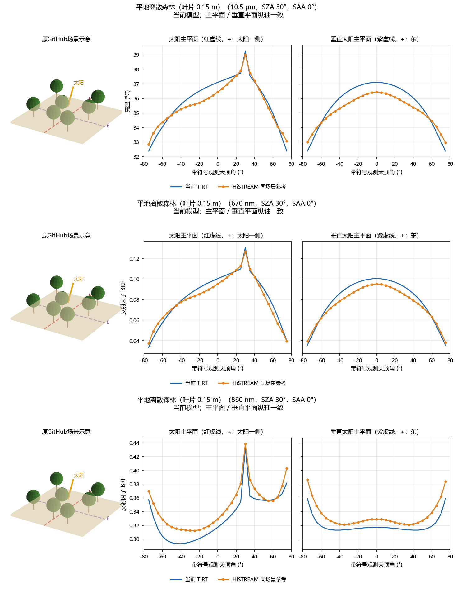
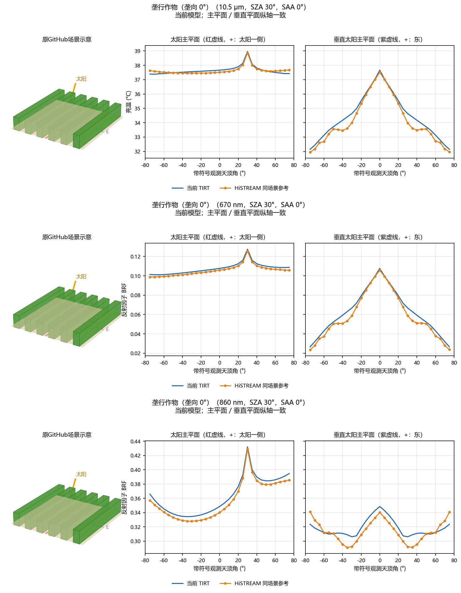
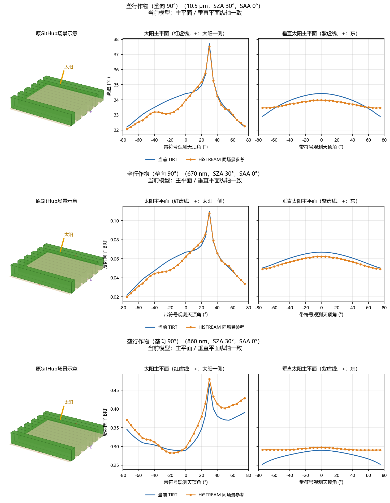
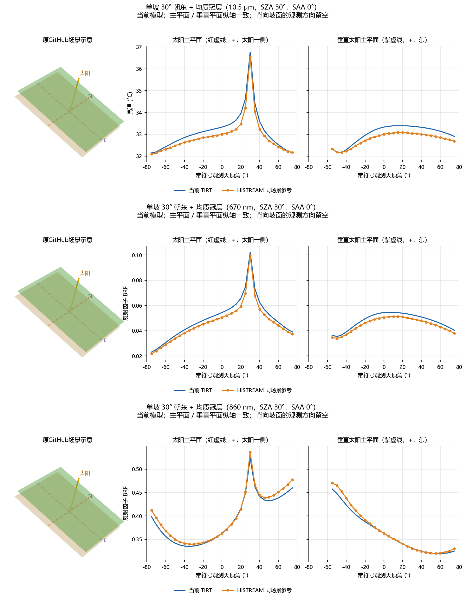
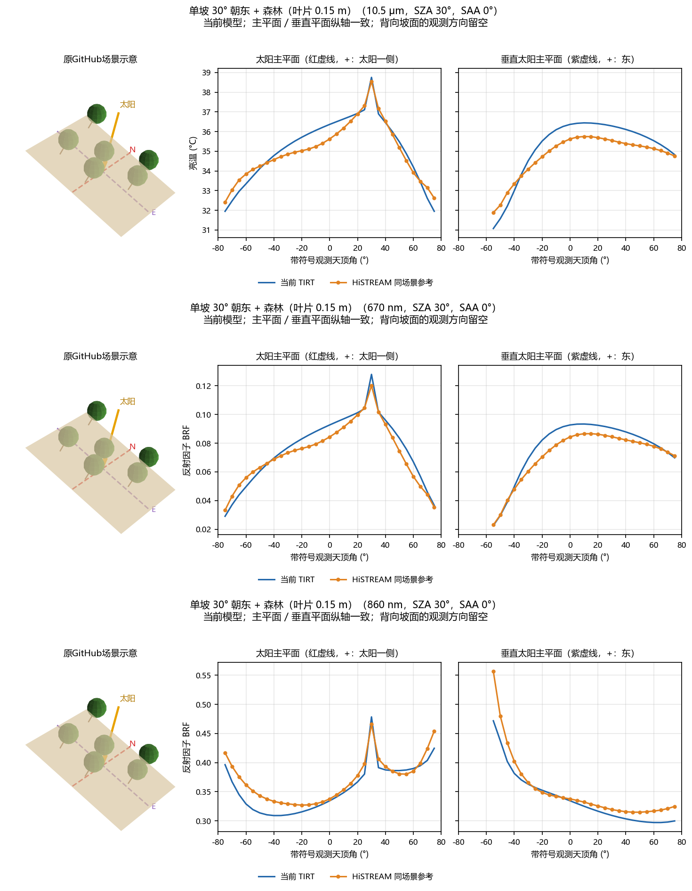
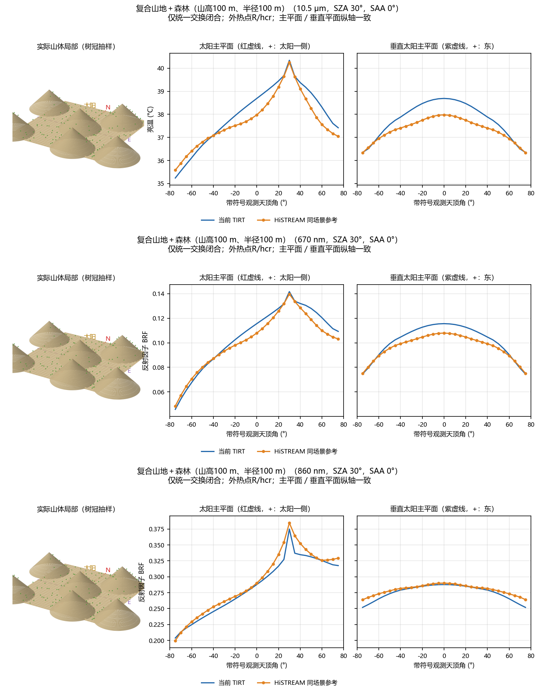
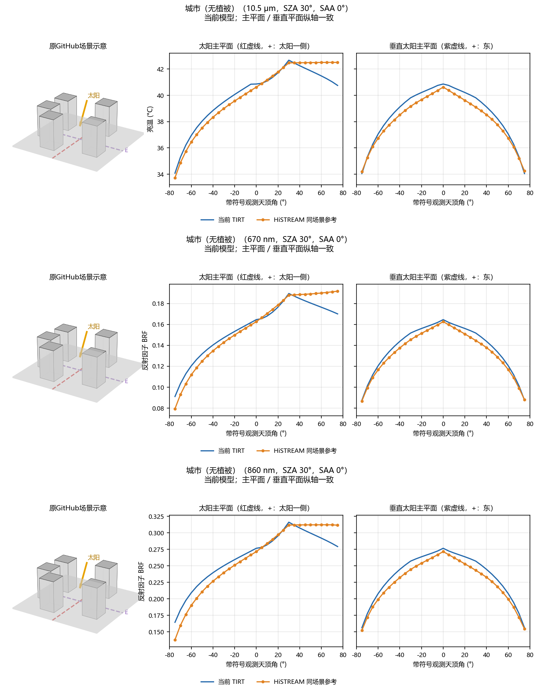
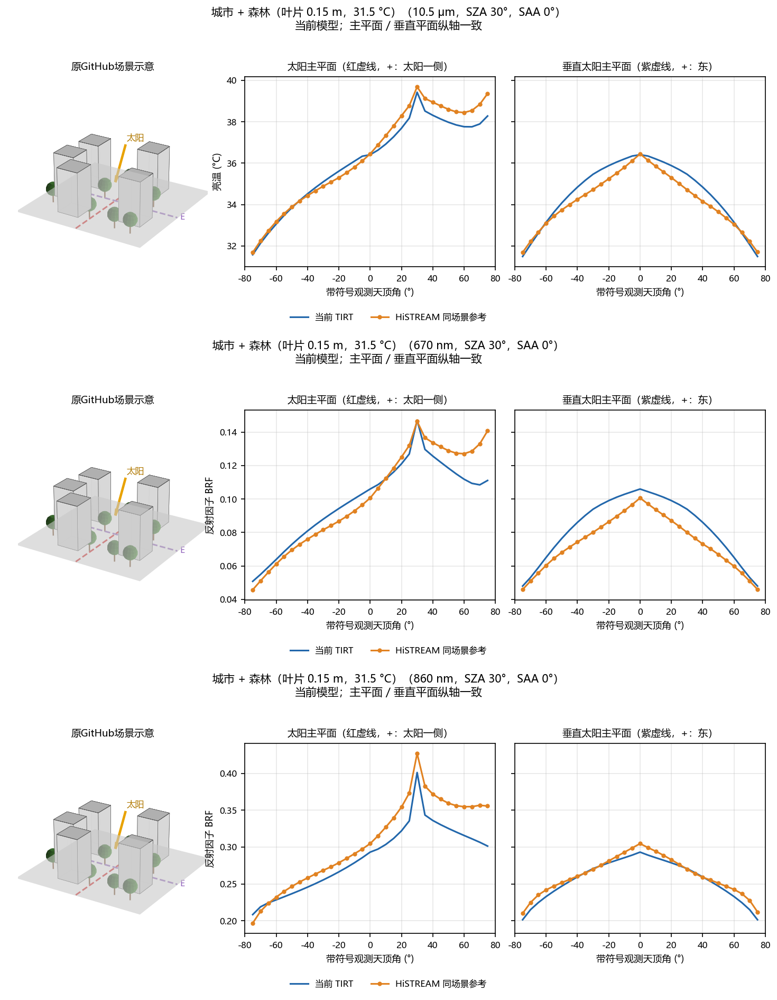

# 当前模型与三波段验证（2026-10-15）

[全部场景结果](#全部场景结果) · [离线图集页面](index.html) · [误差表](accuracy.csv) · [逐方向配对](reference_comparison.csv) · [输入与版本](manifest.json)

10组场景：裸土、均质植被、离散森林、垄向0°/90°作物、单坡均质植被、单坡森林、100 m山地森林、城市裸街道、城市森林。每组10.5 μm热红外、670 nm红光、860 nm近红外；太阳主平面和垂直平面使用相同纵轴。1830条记录中1806条为有效预测，24条为单坡背面方向。

## 当前选择

- 山地森林：山高100 m、半径100 m，球冠半轴2 m（直径4 m），冠底3 m。仅统一交换闭合，外热点保持R/hcr，不叠加冠心高度修正。旧20 m小丘陵和0.9 m叶片森林不在本次图集中。
- 城市森林：热红外现已接入冠内/冠外双热点；光学原有双热点继续使用，没有重复添加。该城市案例热红外RMSE为0.472191 K，红光0.009829、近红外0.019612 BRF（61个独立方向）。
- 光学与热红外使用各自的反射/透射、发射率与源项；没有用反射率替换热辐射。山地共享4状态交换算子，城市保留自身建筑遮挡与散射闭合。
- 其他场景使用当前对应分支，平地垄行热红外使用conditioned_corridor。未指定新开关时保留各入口既有默认；本目录inputs明确选定实际使用的分支。

## 从仓库根目录复算

```bash
python scripts/verify_physics.py
python scripts/validate_current_model.py --plots
```

第一条执行156项物理、输入、GUI API和热点回归。第二条读取本目录10组输入，重新计算TIRT，与已保存预测逐值核对（绝对容差1e-10），然后与冻结HiSTREAM参考配对。结果写入cases/_current_model_validation/。可选--plots生成两观察平面的PNG/PDF，不重建三维光追资产；本目录保留原场景示意的完整图集。可用--output选择其他输出目录。

本包复算不需要原会话目录、HiSTREAM可执行程序或网络。图集可直接下载后打开index.html。HiSTREAM参考来自既有同场景实际光追，未重新运行；统计表和原生参考CSV的SHA256见reference_manifest.json。原生TIFF及HiSTREAM运行时未打包。热红外为固定组分温度的方向验证，不是能量平衡闭合或野外精度验证。

## 近似与边界

整冠双热点为统计参数化，未进行冠体元积分。共享交换仍包含固定角度求积。光学高阶使用各向同性闭合，尤其近红外仍有方向/深度近似；未声称完整BRDF角积分已严格守恒。城市模型未逐树重建建筑与冠层全部三维输运。

原GitHub热红外沿用冻结参考CSV。光学为512²、256样本、depth32。100 m山地热红外为32样本、depth4；20°/90°沿用此前1024²有效重算，其余60方向512²。太阳SZA=30°、SAA=0°；观测0–75°、步长5°，四方位，天底仅计一次。

## 全部场景结果

蓝线为当前TIRT，橙色圆点为同场景HiSTREAM。每组从上到下为热红外、红光、近红外。

| 场景 | 热红外 RMSE / K | 红光 RMSE / BRF | 近红外 RMSE / BRF |
|---|---:|---:|---:|
| 平地裸土 | 0.000055 | 0.000000 | 0.000000 |
| 平地均质冠层（LAI 1.5） | 0.198674 | 0.002719 | 0.005617 |
| 平地离散森林（叶片 0.15 m） | 0.544582 | 0.005093 | 0.016030 |
| 垄行作物（垄向 0°） | 0.288369 | 0.003665 | 0.008903 |
| 垄行作物（垄向 90°） | 0.375394 | 0.004270 | 0.021688 |
| 单坡 30° 朝东 + 均质冠层 | 0.262038 | 0.003201 | 0.007907 |
| 单坡 30° 朝东 + 森林（叶片 0.15 m） | 0.549088 | 0.006204 | 0.020524 |
| 复合山地＋森林（山高100 m、半径100 m） | 0.478383 | 0.005528 | 0.008316 |
| 城市（无植被） | 0.567091 | 0.006865 | 0.012623 |
| 城市 + 森林（叶片 0.15 m，31.5 °C） | 0.472191 | 0.009829 | 0.019612 |

### 1. 平地裸土




### 2. 平地均质冠层（LAI 1.5）




### 3. 平地离散森林（叶片 0.15 m）




### 4. 垄行作物（垄向 0°）




### 5. 垄行作物（垄向 90°）




### 6. 单坡 30° 朝东 + 均质冠层




### 7. 单坡 30° 朝东 + 森林（叶片 0.15 m）




### 8. 复合山地＋森林（山高100 m、半径100 m）




### 9. 城市（无植被）




### 10. 城市 + 森林（叶片 0.15 m，31.5 °C）


