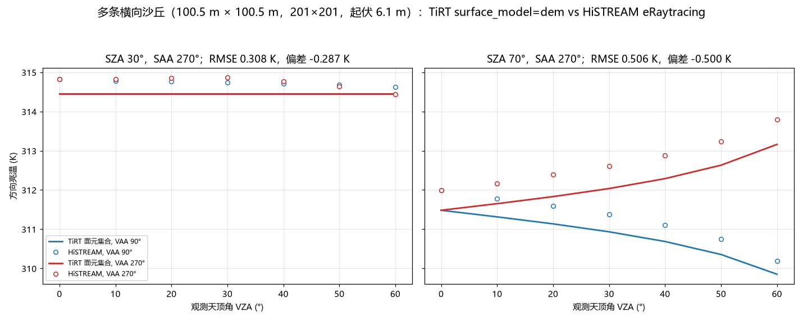

# 多山脊 DEM 对 HiSTREAM 参考（2026-10-29）

用 StreamStudio 的横向沙丘 DEM `assets/dem-library/dune/transverse_dunes_100m.asc` 做一个“多条山脊”对照：HiSTREAM eRaytracing 生成参考，TiRT 用**单坡面元集合**近似同一条 DEM，逐方向比较 10.5 µm 亮温。

## 场景与设置

- DEM：201×201，0.5 m 网格，100.5 m × 100.5 m，起伏 6.13 m，约 6 条横向沙脊。
- HiSTREAM：eRaytracing，256×256 平行投影，32 samples/pixel，depth = 4；地形发射率 0.95，土壤/地形日照/阴影温度 318.15/303.15 K，天空 3 K，大气关闭。
- 太阳：SZA 30°/70°，SAA 270°（从西侧照射长条形沙脊）。
- 观测：VZA 0–60°，步长 10°；VAA 90°/270°（横切沙脊的两个方向）。

## TiRT 近似

1. 从 ASC 逐像元算坡度/坡向（Horn）；
2. 沿太阳方位做 horizon ray march，得到投影阴影像元；
3. 按 2° 坡度 × 10° 坡向分箱，对每个“日照/阴影”面元调用现有 `run._surface_result` 的单坡裸土模型；
4. 按面元投影面积加权平均辐亮度，再转亮温。

这正是 `surface_model=dem` 的实现：逐像元坡度/坡向 + 投影阴影，按面元调用现有 `surface_model=slope` 模型，再按投影面积加权。它只是几何遮蔽 + 固定日照/阴影组分温度的近似；没有逐面元能量平衡、没有山脊间多次反射/cavity 效应，也没有 TIRT 原生 `Terrain` 的锥体面间交换。

## 结果

逐方向误差（TiRT − HiSTREAM）：

| SZA | VAA | RMSE (K) | 偏差 (K) |
| ---: | ---: | ---: | ---: |
| 30° | 90° | 0.288 | −0.282 |
| 30° | 270° | 0.326 | −0.292 |
| 70° | 90° | 0.434 | −0.432 |
| 70° | 270° | 0.570 | −0.568 |

方向性形态与 HiSTREAM 一致：SZA 70° 时 VAA 90° 由 311.99 K 降到 310.20 K，VAA 270° 由 311.99 K 升到 313.79 K；TiRT 对应 311.48→309.85 K 和 311.48→313.16 K。TiRT 整体低约 0.3–0.6 K，最可能来自缺少山脊间多次反射和阴影边界的离散化；这也说明“直接拿圆锥 `terrain` 代替山脊”不够。



原始逐方向数据见 `ridge_compare.csv`，HiSTREAM 参考见 `histream_ridge.csv`。

## 复现

```powershell
# 需要 StreamStudio 的 HiSTREAM 引擎和 DEM；本机路径如下
$env:STREAMSIM_ROOT = 'C:\work\streamstudio'
$py = 'C:\work\tirt\.venv\Scripts\python.exe'
& $py validation\ridge_20261029\run_histream_ridge.py       # 生成 histream_ridge.csv
& $py validation\ridge_20261029\compare_ridge_tirt_dem.py   # 用 surface_model=dem 生成 ridge_compare.csv
& $py validation\ridge_20261029\plot_ridge_compare.py       # 生成 ridge_vs_histream.png
```

`compare_ridge.py` 保留为早期独立原型（不使用 `surface_model=dem`），用于交叉核对。`build_ridge.mjs` 默认读取 `C:\work\streamstudio\assets\dem-library\dune\transverse_dunes_100m.asc`，可用 `--dem` 换其他 ASC；`HISTREAM_EXE` 可覆盖引擎路径。
